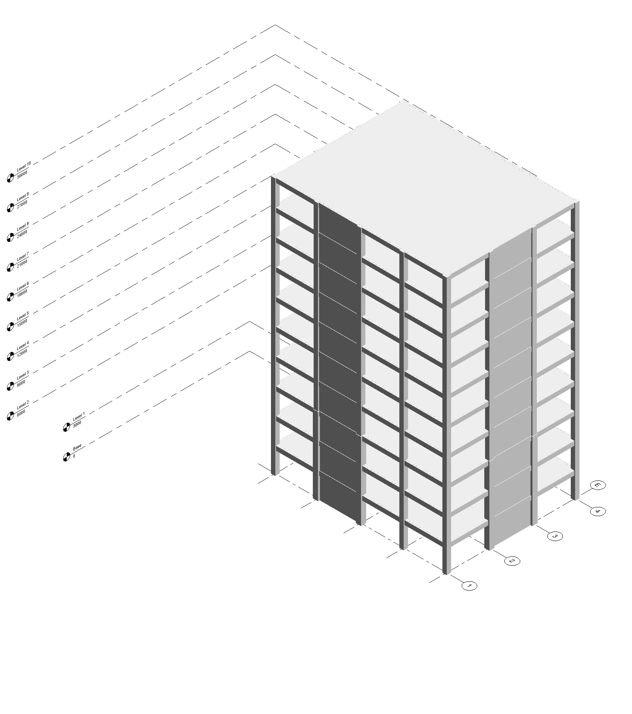

# BIM model: 10-storey precast RC reference building (Revit 2027)



A simple structural BIM model of the Paper 2 reference building in its recommended precast scheme: **M2 with 600x600 boundary columns in storeys 1–3** (see `../Paper2_Structural/analysis/results_summary.md`). The model was generated automatically through the Revit API, so it can be regenerated identically.

| File | Content |
|---|---|
| `Prefab_RCC_10storey.rvt` | Revit 2027 project |
| `Prefab_RCC_10storey.ifc` | IFC4 Reference View export (open BIM, readable without Revit) |
| `Prefab_RCC_10storey_3D.png` | Isometric 3D view |
| `build_log.txt` | Log of the last automated build |
| `addin/` | C# source of the Revit add-in that builds the model (`App.cs`, `PrefabBIM.csproj`, `PrefabBIM.addin`) |
| `task.txt` | Original note on a future SAPFire → Revit pile-foundation model (not yet done) |

## What is modelled
| Element | Revit family / type | Count | Mark pattern |
|---|---|---|---|
| Levels | Base (0.000) + Level 1–10 at 3.0 m spacing | 11 | — |
| Grids | A–E (x = 0…20 m at 5 m), 1–4 (y = 0…15 m at 5 m) | 9 | — |
| Columns | M_Concrete-Rectangular-Column: **C 500x500**; **C 600x600** at the 8 wall-end positions, storeys 1–3 | 200 | `PC-C-<grid>-S<n>` |
| Beams | M_Concrete-Rectangular Beam: **B 300x500**, on every grid line at every level | 310 | `PC-B-L<n>-<k>` |
| Walls | **PC Wall 200** (single 200 mm concrete layer), one precast panel per storey: WY1 (x=0, y 5–10), WY2 (x=20, y 5–10), WX1 (y=0, x 5–10), WX2 (y=15, x 10–15) | 40 | `PC-W-<wall>-S<n>` |
| Floors | **PC Slab 150** (single 150 mm concrete layer), 20 m x 15 m | 10 | `PC-S-L<n>` |
| Material | Concrete C28 (precast) | — | — |

Every element carries the Comment "Precast element; Paper 2 scheme M2 + 600x600 boundary columns S1-S3". The IFC contains the same counts (200 IfcColumn, 310 IfcBeam, 40 IfcWall, 10 IfcSlab, 11 storeys).

**Not modelled:** foundations (the soil report recommends bored piles, ~21–24 m into dense sand), stairs and lift, openings, partitions and finishes, reinforcement, and connection hardware. These are natural next steps (see `task.txt`).

## Regenerating
Requires Revit 2027 and the .NET 8 SDK.
```
cd BIM/addin
dotnet build -c Release
copy PrefabBIM.addin "%APPDATA%\Autodesk\Revit\Addins\2027\"
set PREFAB_BIM_JOB=1
"C:\Program Files\Autodesk\Revit 2027\Revit.exe" /language ENU
```
The add-in does nothing unless `PREFAB_BIM_JOB=1` is set. With it set, the add-in builds the model from the *Structural Analysis-DefaultMetric* template, saves the RVT, exports the IFC and PNG, and closes Revit. Adjust the absolute paths in `App.cs` and `PrefabBIM.addin` to your checkout, and remove the manifest from the Addins folder afterwards.
