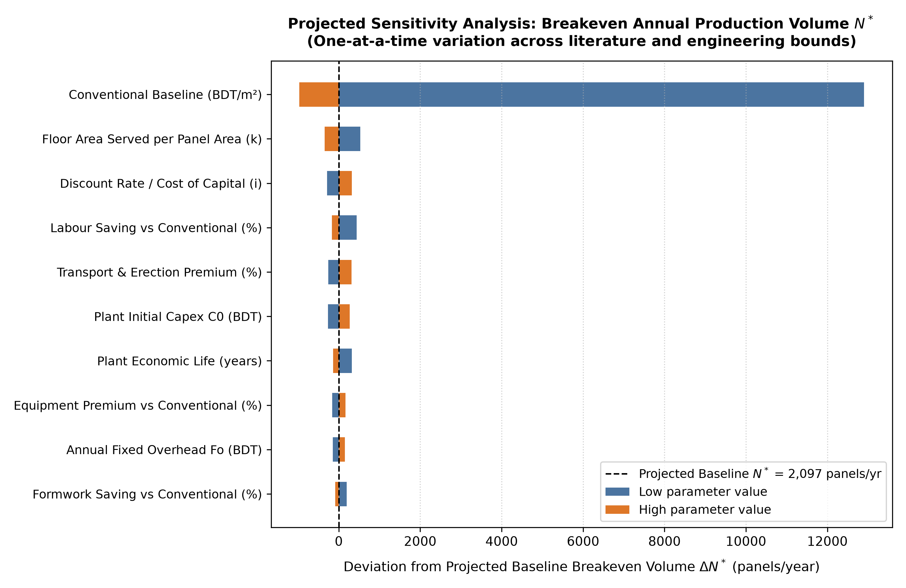
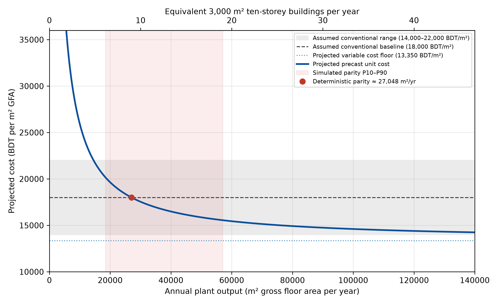
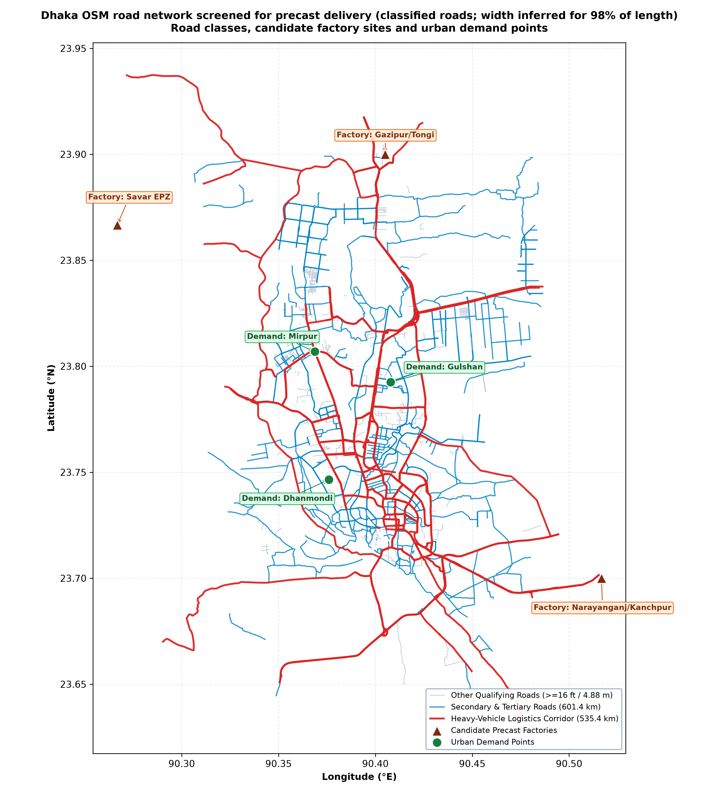

# Conditions for Precast Reinforced Concrete Construction in Bangladesh: A Regulatory, Economic and Logistics Pre-feasibility Assessment

## Authors

Shahjahlal Ahmed Sifat, Golam Kuadir Khan Prince, and Md. Sifat Ul Islam  
Hajee Mohammad Danesh Science and Technology University, Dinajpur, Bangladesh

## Abstract

**Purpose:** To identify the regulatory, economic, logistical and institutional conditions under which precast reinforced cement concrete (RCC) construction could be feasible in Bangladesh.

**Design/methodology:** This desk-based pre-feasibility study combines content analysis of BNBC 2020 and Dhaka planning rules, secondary-source assessment of supply-chain and workforce readiness, projected plant economics, OpenStreetMap (OSM) network analysis for Dhaka, and bounded comparisons with India and Malaysia. A partial Dhaka construction payment register is used only as cost-structure evidence.

**Findings:** BNBC recognises precast but implementation requires positive load paths, integrity ties, engineered connections and auditable quality control. The code does not specify a local connection-test accreditation route. Under stated assumptions, a single plant reaches projected cost parity at about 27,000 m² of floor area per year (simulated median 28,500 m²; P10–P90 18,500–57,100 m²), roughly nine 3,000 m² buildings or 4,200–6,300 large panels per year; at half that output the projected premium is about 28%. Parity is dominated by the uncertain conventional cost baseline. OSM screening of Dhaka identifies a connected 1,236 km network of major roads, but 98% of its length lacks measured width and none carries weight-limit data, so routes still require field verification. Basic materials appear more accessible than specialised equipment, skills and certified connections. India and Malaysia illustrate how standards and predictable public demand may support adoption, though transfer is conditional.

**Originality:** The paper integrates code interpretation, corrected plant economics and network topology into a Bangladesh-specific assessment. It claims no measured savings or building-specific seismic adequacy.

**Keywords:** precast concrete; reinforced concrete; Bangladesh; BNBC 2020; pre-feasibility; industrialised construction; Dhaka; logistics

## 1. Introduction

Bangladesh’s urban growth creates continuing pressure to deliver housing and infrastructure with predictable quality and time. The 2022 Population and Housing Census reports an urban population share of 31.66% (Bangladesh Bureau of Statistics [BBS], 2023). Construction remains organised largely around project-specific cast-in-situ work. Precast reinforced concrete relocates production of structural elements to a controlled facility, then transports and assembles them on site. Potential advantages—repeatable production, reduced site formwork and less weather exposure—depend on standardised designs, adequate demand, transport access, lifting capacity, skilled erection and reliable connections.

The question in Bangladesh is not whether precast is technically imaginable. BNBC 2020 has a dedicated precast section. The practical question is whether a project can satisfy code and planning requirements while securing the production volume, materials, skills, equipment and routes needed to deliver components at competitive total cost. These conditions are linked: a plant requires sustained orders; large orders require reliable approval and certification; both rely on a construction ecosystem able to transport and erect components safely.

Bangladesh-focused studies identify anticipated benefits and obstacles, including initial investment, skills, transport, local manufacturing and coordination (Arafat et al., 2025; Chowdhury, 2022). Yet the evidence has gaps: no study has combined clause-level code analysis, plant economics and network data for Bangladesh. This paper revises and supersedes an earlier working-paper version (SSRN) by narrowing its scope to pre-feasibility and adding clause-level code analysis, a corrected projected economic model, a partial material payment register used only for cost composition, and OSM network analysis. Results are screening evidence, not validated project outcomes.

The main question is: **Under what regulatory, economic, logistical and institutional conditions is precast RCC construction feasible in Bangladesh?** Five sub-questions structure the analysis:

1. **SQ1—Regulation:** Where do BNBC 2020 and RAJUK provisions enable or constrain precast RCC?
2. **SQ2—Supply chain:** How ready are material supply chains, workforce capabilities and equipment?
3. **SQ3—Cost and scale:** What do projections imply about cost and production scale for competitiveness?
4. **SQ4—Logistics:** What does Dhaka’s network imply for urban delivery, and what limits rural deployment?
5. **SQ5—Institutions:** Which policy and institutional conditions could support adoption, and how should they be sequenced?

The contribution is an integrated pre-feasibility framework joining code conditions, plant economics and network evidence while distinguishing facts, assumptions and limitations. It is not a structural design evaluation. Structural/seismic performance of a representative building is addressed in a companion manuscript (“Paper 2”) and is outside this scope. No ETABS results, building-specific compliance or tested connection performance are claimed.

## 2. Literature review

### 2.1 Adoption in developing construction markets

Off-site production (OSP) is often justified by moving repetitive work into controlled settings, reducing exposure to weather and congestion, and improving repeatability. These benefits are conditional: design must be resolved earlier, interfaces coordinated, and production, delivery and erection treated as one project system. Blismas et al. (2006) argue that benefit assessment should account for multiple project outcomes rather than direct cost alone. Goodier and Gibb (2007) report that actors perceive benefits and drawbacks differently, identifying weak comparative-cost information and shortages of multi-skilled factory labour as constraints. Pan et al. (2008) show that uptake depends on housebuilders' business strategy, while their integration framework stresses early decisions and alignment across the house-building process (Pan et al., 2012). Systematic reviews reinforce this interdependence: Wuni and Shen (2019) synthesised drivers including time, cost, quality, productivity, market, sustainability and policy; their framework treats drivers as connected. Their review of modular integrated construction barriers identified interacting financial, technical, process, industry and knowledge constraints across 15 countries (Wuni & Shen, 2020). These global syntheses do not establish Bangladesh-specific rankings. Polat (2010) compared US and Turkish precast markets and found communication and shortages of experienced engineers and contractors may constrain uptake; transport size and load restrictions were prominent in US responses. Malaysian IBS studies identify perceived additional cost, financing, skills and knowledge, delivery and supply-chain coordination, and doubts about design flexibility as barriers (Mohd Nawi et al., 2011). A survey of large Malaysian contractors also recorded implementation problems despite policy attention (Kamar et al., 2014). Chan’s (2011) Australia–Malaysia case comparison illustrates a labour-capital trade-off: mechanised precast can be attractive where labour is expensive, while low wages may preserve the advantage of labour-intensive in-situ work. Jaillon and Poon (2009, 2010) describe how public housing and standardised design supported Hong Kong prefabrication, while site-specific design constrained reuse. For Bangladesh, Arafat et al. (2025) identify skills and training, transport, initial investment, local manufacturing and coordination concerns. Urban housing also includes incremental, owner-led construction rather than only standardised developer projects. Industrialised solutions may therefore fit repeatable institutional, apartment or public projects more readily than dispersed individually financed construction; this is a screening proposition, not a measured adoption pattern.

Recurring barriers include capital intensity, uncertain project pipelines, limited standardisation, unfamiliarity among designers and contractors, and specialist lifting and connection work. These can reinforce one another: manufacturers await orders, developers await qualified suppliers, and training is difficult to sustain without recurring projects. Public procurement can coordinate demand and capability, but a mandate without compliant designs and quality assurance may transfer risk rather than resolve it.

### 2.2 Cost and production scale

Precast economics combine variable material, production, delivery and erection costs with fixed investment in moulds, batching, handling, storage, design coordination and quality systems. Higher throughput and repetition can spread fixed costs, while low utilisation and bespoke designs can preserve a premium. Mao et al. (2016), using multiple Chinese cases, found higher total costs for off-site or semi-off-site approaches, with production, transport and design consultancy among major cost items, while selected finishing costs fell. Hong et al. (2018) likewise found incremental cost across eight Chinese projects, correlated with prefabrication rate; transport accounted for 10% within their cost boundary. Neither study supports treating factory production as sufficient for parity in immature markets. The evidence does not yield one general cost verdict. Pan and Sidwell (2011) identify inconsistent scope and opaque comparisons as part of the cost barrier. Conversely, repetition and high utilisation can improve economics. In Hong Kong, Jaillon and Poon (2010) report time and design/construction cost savings where standard components were reused, although site conditions limited that reuse. These are case findings, not transferable unit-cost coefficients. Scale is therefore a condition to be evaluated, not an assumed cure: fixed capital and design costs can be spread over repeated orders, but a plant with intermittent work may retain idle-capacity and inventory costs. Comparisons must therefore include production, delivery, erection and avoided site trades at the same scope; neither Hong et al. (2018) nor Mao et al. (2016) reports a universal formwork or labour saving percentage. Industry-level estimates point the same way: McKinsey Global Institute (2017) puts break-even for a precast housing plant at several thousand dwelling units per year, a figure that is context-specific and not directly comparable with panel or floor-area output. Single-building comparisons are narrower still; Kankuntla et al. (2020), for example, modelled one G+3 building in India and reported ₹1,200/ft² for a prefabricated option against ₹1,400/ft² for conventional construction, which is not a national benchmark. Jaillon and Poon (2008) report reduced site labour and waste in Hong Kong cases, but that context and system differ from Bangladesh RCC.

Time and cost advantages should be stated at the measured scope. A study of two Lima residential projects found better time performance for precast slabs (Verán-Leigh et al., 2022), while Kim et al. (2020) reported productivity improvement in a precast double-wall retaining-wall application. These cases support the plausibility of gains but establish no transferable Bangladesh-wide percentage. Alshamrani’s (2022) Saudi townhouse model also demonstrates that rankings depend on system configuration and assessment boundary; it does not justify a general prefab premium or saving.

### 2.3 Logistics and spatial market limits

Logistics links factory location, order sequence, vehicle capacity, route geometry, bridge capacity, site storage and erection access. Hsu et al. (2018) formulate modular-construction logistics as an integrated production, transport and inventory problem under uncertain site demand; this frames delivery as coordination rather than a simple distance allowance. Research on prefabricated-component supply chains likewise models supplier, route, schedule and site-layout decisions together (Zhang & Yu, 2020). Polat (2008) found transport size and load restrictions among significant precast-use barriers in US survey responses, while Hong et al. (2018) identified transport as a material cost component in Chinese projects. Reported shares vary by product and accounting boundary and should not be treated as a fixed percentage or delivery radius. Physical access is as important as line-haul distance: width, turning geometry, overhead clearance, bridge loading, pavement, traffic restrictions, crane set-up and staging need project-level checks. Network analysis can identify candidate corridors but cannot certify safe or legal delivery.

Rural deployment faces additional constraints where roads, bridges, turning areas, cranes and staging are less available. This study has no rural road GIS dataset, so its rural assessment is literature-based, not a measurement of rural conditions.

### 2.4 Regulation and Bangladesh-specific evidence

BNBC 2020 Part 6, Chapter 6, Section 6.10 explicitly covers precast concrete and includes structural integrity, connection and bearing provisions (Bangladesh, Ministry of Housing and Public Works, 2021). Code recognition does not qualify a proprietary connection, factory or product. fib Bulletin 43 treats connections as integral to structural behaviour and addresses force transfer alongside production, handling, erection and durability (fib, 2008); the PCI Design Handbook provides design procedures and aids within referenced US standards (Precast/Prestressed Concrete Institute [PCI], 2017). Neither substitutes for Bangladesh authority acceptance or project-specific design. BNBC Section 6.10.6.1.1 permits adequacy to be established by analysis or test, making transparent assumptions, traceability and reviewable evidence central to implementation.

Malaysia's Industrialised Building System (IBS) policy illustrates public procurement's demand-coordination role. CIDB's 2019 report documents different rules for qualifying government and private projects and, in its 500-respondent survey, reports IBS use by 36.1% of government and 33.1% of private projects; this survey measure differs from its secondary series on federal building projects (Construction Industry Development Board Malaysia, 2021). Kamar et al. (2014) and Mohd Nawi et al. (2011) indicate policy does not automatically remove skills, finance, perception and supply-chain barriers. In India, PMAY-U and GHTC-India included alternative technologies, and the Lighthouse Projects programme began in 2019 (Government of India, Ministry of Housing and Urban Affairs, 2019; Press Information Bureau, Government of India, 2019, 2020). Neither programme means all housing used precast RCC. India also has standards for large-panel prefabrication and precast building design (Bureau of Indian Standards, 1985, 2010).

Bangladesh evidence on off-site adoption remains limited: the available qualitative study maps perceived implementation constraints, while broader housing research describes heterogeneous and incremental urban building practices. The literature located here does not establish national precast market share, audited cost premium, local production-capacity baseline, accredited connection-testing route or heavy-haul delivery radius. This study addresses the gap between code permissibility and implementation readiness by joining clause-level code review, supply-chain evidence, a transparent projected plant-cost model and Dhaka network screening. It offers a conditional pre-feasibility assessment; it does not establish seismic adequacy, project savings or national readiness.

## 3. Methodology

### 3.1 Design and framework

This desk-based mixed-method pre-feasibility assessment combines qualitative documentary analysis with quantitative deterministic, probabilistic and network analyses; it does not include primary interviews or experimental tests. The sequence is: (1) examine code and planning conditions; (2) assess documented material, skill and equipment readiness; (3) model projected cost and scale; (4) analyse the Dhaka road graph; (5) compare institutional approaches in India and Malaysia; and (6) synthesise conditions in a feasibility matrix. The output is a screening judgement, not investment appraisal or design approval.

### 3.2 Regulatory content analysis

BNBC 2020 was examined for precast provisions, construction inspection and testing, minor alterations and urban development. Clause numbers and quoted values were checked against the Gazette text. Focus provisions are Part 6, Chapter 6, Section 6.10, especially 6.10.5 and 6.10.6; Part 6, Table 6.2.19; Part 2, Chapter 3, Sections 3.1, 3.8.5 and 3.8.8; and Part 3 provisions on approach roads. RAJUK’s official rules page was reviewed for Dhaka planning regulation status (Rajdhani Unnayan Kartripakkha [RAJUK], n.d.). This is a content analysis, not legal advice or a substitute for project authority review.

### 3.3 Supply-chain and workforce readiness

Materials, workforce and equipment were assessed using published Bangladesh literature, including Arafat et al. (2025), Ahmed et al. (2020), and a documented BOQ register. The handwritten anonymised register records partial material payments for one Dhaka cast-in-situ project. It was used for cost-category shares only, not unit cost. No supplier interviews, workforce survey or equipment census was undertaken. “Available” therefore denotes a broad domestic construction input, not audited precast-grade supply.

### 3.4 Projected cost model

All cost and scale outputs are projections. The deterministic model uses a conventional core-and-shell baseline of 18,000 BDT/m², an assumption inherited from the working paper and not validated by the partial BOQ. The adjustment assumptions, derived from the literature and the working paper, are material −8%, labour −60%, plant +150%, transport +230%, formwork −80%, quality control/testing +150%, and overhead/preliminaries −12.5%. They yield projected cost of 15,300 BDT/m² at design scale, 15% below the assumed baseline. This is an illustrative scenario, not a bid estimate.

Annualised plant economics use:

\[
\mathrm{CRF}=\frac{i(1+i)^n}{(1+i)^n-1}, \quad F=C_0\cdot\mathrm{CRF}+F_o,
\]

where \(i\) is annual discount rate, \(n\) plant life, \(C_0\) initial capital and \(F_o\) annual fixed overhead. Unit cost per floor-area equivalent is

\[
c(Q)=v+\frac{F}{Q}+t,
\]

where \(Q\) is plant output in m² of gross floor area per year, \(v\) variable manufacturing cost per m² GFA, and \(t\) transport and erection cost per m² GFA. Parity is

\[
Q^*=\frac{F}{c_{conv}-v-t},
\]

and the equivalent number of panels of area \(A\) is \(N^* = Q^*/(A\,k)\), where \(k\) is floor area served per m² of panel.

where \(c_{conv}\) is the conventional baseline. Throughput is expressed in m² of gross floor area (GFA) per year, so that results do not depend on how floor area is converted into panels. The fixed annual cost \(F\) is calibrated so that the plant and overhead allowances in Table 3 (1,250 and 700 BDT/m²) are exactly recovered at a design throughput of 64,500 m² GFA/year, with a 10% discount rate and 15-year plant life; this implies \(C_0 \approx\) 613 million BDT (about USD 5.0 million at 122 BDT/USD) and \(F_o\) = 45.15 million BDT/year. Because \(F\) is derived from the same assumptions as Table 3, the parity volume is a consequence of those assumptions, not an independent estimate of plant economics; a bottom-up plant budget is identified as future work. For interpretation, GFA is translated into buildings using a 3,000 m² ten-storey reference building (20 m × 15 m plan) and into 4.3 m × 3.0 m (12.9 m²) panels using 2.0–3.0 m² of panel per m² of floor (\(k\) = 0.33–0.50), as in large-panel systems where both slabs and walls are precast [AUTHORS: confirm against the reference building's panel layout]. Fixed annual cost is constant across output scenarios. Sensitivity varies conventional baseline and plant, labour, transport, capital and conversion assumptions. A 10,000-draw triangular Monte Carlo simulation (fixed seed 42) over the conventional baseline, labour and formwork savings, transport premium, capital cost, overhead, discount rate and plant life estimates parity uncertainty and modelled probability of lower cost. These are conditional on specified ranges, not empirical frequencies.

### 3.5 GIS network analysis

The OSM extract (archived in the project repository) includes roads qualifying at ≥16 ft (about 4.88 m) by explicit width, inferred lane count or inferred functional class. It contains 3,441 segments and 1,235.67 km. Explicit width tags are sparse, so the threshold is not field-verified for every link. Lengths were cross-checked using haversine distance. Graph nodes were formed by rounding vertices to 10⁻⁵ degrees (about 1.1 m); Dijkstra’s algorithm calculated shortest paths from candidate industrial-periphery origins to urban demand points. Snap distances were recorded and disconnected routes were not imputed. Traffic, time restrictions, turning radius, overhead clearance, bridge rating, pavement condition and vehicle swept paths were not modelled.

### 3.6 Comparative case analysis

India and Malaysia were selected because published sources document public programmes, technical standards or procurement frameworks relevant to industrialised construction. Comparison is limited to adoption instruments and enabling conditions, not causal attribution of national outcomes. Vietnam was excluded because the available sources did not provide sufficient verifiable evidence for a balanced case.

### 3.7 Synthesis and rating rules

The matrix uses **conditionally feasible** where a code or basic input exists but identified conditions must be met; **partially feasible** where some enablers exist but material, network or capability gaps remain; and **not demonstrated** where evidence cannot establish readiness. Ratings concern this evidence base, not every possible project. In the provision-level matrix (Table 1), **enabling** marks a provision that permits precast without further project-specific conditions, and **conditional** marks one that can be met only if stated conditions are satisfied. Structural/seismic performance is conditional because provisions exist but no building-specific verification is presented.

### 3.8 Validity and limitations

Validity is supported by direct clause checking, transparent assumptions and separation of measured network attributes from inferred width and operational suitability. Limitations include secondary sources, uncertain cost assumptions, partial/inconsistent BOQ records, OSM gaps and a clipped study boundary. No stakeholder sample, laboratory test, field route survey, supplier census or building-specific structural analysis is included. Several references are provisional and need bibliographic verification. Inference is limited to pre-feasibility screening.

## 4. Results

### 4.1 Regulatory analysis

BNBC 2020 enables precast RCC by recognising it under Section 6.10; it does not exempt precast from general structural, seismic, quality or planning requirements. Structural integrity must be designed explicitly. Section 6.10.5.1.2 requires diaphragm-to-supported-member connections of at least 4.4 kN per linear metre. Section 6.10.5.1.3 requires precast columns to have a nominal tensile strength of at least 1.4\(A_g\) (N) and wall panels to have at least two ties, each of at least 44 kN nominal tensile strength. Section 6.10.5.1.4 prohibits connections relying solely on gravity-induced friction. For precast bearing-wall buildings of three or more storeys, Section 6.10.5.2 specifies: longitudinal and transverse floor/roof ties of 22 kN/m within 600 mm of the floor plane; longitudinal ties at no more than 3 m centres; transverse ties no farther apart than bearing-wall spacing; perimeter ties within 1.2 m of the edge with 71 kN capacity; and continuous vertical ties of 44 kN per horizontal metre of wall, at least two per panel (Bangladesh, Ministry of Housing and Public Works, 2021).

Dhaka is Seismic Zone 2, Z = 0.20, under BNBC 2020 Tables 6.2.14 and 6.2.15. This is a design input, not proof of safety. Table 6.2.19 marks ordinary reinforced-concrete shear walls in bearing-wall systems as not permitted in Seismic Design Category D and limits special reinforced-concrete shear walls in bearing-wall systems to 50 m in SDC D; a precast wall system therefore has to qualify as a special system, with corresponding detailing and connection evidence, wherever SDC D governs. No building-specific structural verification is claimed. The seismic status in Table 1 is **Conditional**, pending system selection, ductile detailing, connection design and project-specific analysis or testing.

There is a practical tension between site-oriented inspection provisions and off-site manufacture. Part 2, Section 3.8.5 requires the owner to inform the Building Official as defined construction stages are reached, and Section 3.8.8 requires test results demonstrating conformity to be preserved at the site and made available for inspection during execution of the work. Precast production and curing take place elsewhere. Implementation therefore requires traceable factory records, authorised inspection, element identification and acceptance documentation at installation. Section 6.10.6.1.1 requires connection adequacy to be determined by analysis or test. It provides routes but no local accredited test protocol or product certification pathway is identified in reviewed sources. This is an institutional implementation gap, not a prohibition on factory production.

The “minor alterations” issue also merits careful interpretation. Part 2, Chapter 3, Section 3.1 exempts listed minor works, including opening or closing a window, door or ventilator and providing partitions, from the permit requirement, but only where they do not otherwise violate the Code's general building, structural stability and fire safety requirements. In a load-bearing panel system, a change intersecting a structural panel, reinforcement, diaphragm or connection can alter the load path. The exemption therefore does not authorise structural cutting; the risk is that owners and small contractors misunderstand its reach unless occupancy documentation distinguishes non-structural changes from prohibited structural alterations. A precast scheme therefore needs as-built information, owner guidance, alteration control and authority review.

Planning conditions affect repeatability and delivery. Dhaka Metropolitan Building Construction Regulations and related RAJUK rules shape envelope, plot coverage, setbacks, access and approval. Plot-specific geometry may require non-standard layouts, increasing design and mould variation unless standard components are coordinated with a family of plot modules. BNBC Part 3 sets minimum approach-road widths (10.8 m for plots other than residential and specified assembly occupancies), but legal access does not guarantee turning, staging or crane set-up for precast erection. The implication is a design coordination condition, not a categorical barrier.

Table 1 summarises these provisions and the condition each imposes on a precast scheme.

**Table 1. BNBC and planning compliance/conditions matrix**

| Topic | Requirement or condition | Assessment | Implication |
|---|---|---|---|
| Code recognition | BNBC Part 6, Chapter 6, Section 6.10 addresses precast | Enabling | Use is within the code framework; project evidence remains necessary |
| Seismic design | Dhaka Zone 2, Z = 0.20; detailing and system limits depend on selected system | **Conditional** | No building-specific structural verification is claimed here |
| Integrity ties | Sections 6.10.5.1–6.10.5.2 specify ties; gravity-friction-only connections prohibited | Conditional | Connections and load paths must be detailed and documented |
| Connection adequacy | Section 6.10.6.1.1 permits analysis or test | Conditional | Local test/accreditation and acceptance route not identified |
| Inspection and records | Part 2, Sections 3.8.5 and 3.8.8: stage notification; test results kept at site | Conditional | Factory QA and traceability must accompany installed elements |
| Minor alterations | Part 2, Section 3.1 exempts listed minor works if structural stability is not compromised | Conditional | Structural panel alterations need owner guidance and controls |
| Plot geometry/setbacks | RAJUK/BNBC controls envelope, coverage, setbacks and access | Conditional | Modular catalogue must accommodate plot envelopes |
| Approach access | Access provisions do not establish vehicle-specific swept path or staging | Conditional | Verify route and site for each project |

### 4.2 Materials and supply chain

Available evidence indicates a domestic base for ordinary concrete inputs—cement, aggregates, sand and reinforcement—because these are already used in conventional RCC construction. This does not verify a precast-grade chain. Grading, batching, steel traceability, inserts, anchors, grout, bearings, sealants and connection hardware require specification and quality assurance. No systematic supplier audit or market-wide test certificate review was available.

Table 2 sets out readiness by input and the precast-specific condition attached to each.

**Table 2. Material and supply-chain readiness**

| Input/capability | Evidence | Readiness | Precast-specific condition |
|---|---|---|---|
| Cement, aggregate, sand | Conventional Dhaka RCC use; register lists cement, stone chips and sand | Baseline available; conformity not audited | Mix qualification, grading and production control |
| Reinforcing steel | Recorded in register; standard RCC input | Baseline available; grade/traceability not audited | Lot traceability, anchorage and connection detailing |
| Ready-mix concrete | Large RMC entry in partial register | Supply exists for conventional work; plant capability unverified | Controlled precast batching, placement and curing records |
| Inserts, couplers, bearings, grout, sealants | No supplier inventory available | Not demonstrated at scale | Approved specifications, testing and reliable supply |
| Moulds, anchors, handling systems | No plant/vendor census | Not demonstrated | Capital investment, standardisation and maintenance |
| Factory quality system | No audited factory evidence available | Not demonstrated | Traceable production control and inspection |

The register is cost-structure evidence only. Formwork/scaffolding/shuttering is about 46% of combined recorded structural-material and formwork entries; RMC is about 55% and rebar about 29% of listed core-shell section A (BOQ audit notes). The register is materials-only, partial, internally inconsistent, has no confirmed GFA, and shuttering is reusable capital. These shares make formwork salient but establish neither a unit cost nor an 80% realised saving.

### 4.3 Workforce, equipment and process

Precast shifts labour demand rather than eliminating it. Site work may require less formwork and concreting, while factory production requires mould preparation, reinforcement assembly, batching, curing, dimensional checks, lifting, storage and dispatch. Erection needs trained riggers, crane operators, signalers, connection installers, surveyors and quality staff. Bangladesh workforce research identifies gaps in technical knowledge and professional training, but is bounded evidence rather than a national census (Ahmed et al., 2020). The Bangladesh qualitative study also identifies skills and training as concerns (Arafat et al., 2025).

The implied chain is design freeze and shop drawings; approved mould and reinforcement setup; controlled casting and curing; dimensional/strength checks; element identification; transport planning; just-in-time delivery; lifting and temporary bracing; connection completion and inspection; and closure of non-conformances. Equipment includes batch controls, reusable moulds, overhead or gantry handling, trailers, cranes, lifting gear and temporary bracing. No national inventory or hire-rate dataset was available. Equipment readiness is partially feasible for pilots using specialist procurement, but broad deployment is not demonstrated.

### 4.4 Projected cost and scale

Every cost value below is projected. The 18,000 BDT/m² conventional comparator is an assumption, not a BOQ-derived rate. The 5,000-panel result is a scenario based on assumed cost shares and adjustment factors, not a quotation.

Table 3 gives the projected comparison at design throughput.

**Table 3. Projected core-and-shell comparison (BDT/m² GFA)**

| Cost component | Conventional assumed | Precast projected at design scale | Projected variance |
|---|---:|---:|---:|
| Materials | 10,000 | 9,200 | −8.0% |
| Labour | 4,000 | 1,600 | −60.0% |
| Equipment/plant | 500 | 1,250 | +150.0% |
| Transport | 500 | 1,650 | +230.0% |
| Formwork | 2,000 | 400 | −80.0% |
| QC/testing | 200 | 500 | +150.0% |
| Overhead/preliminaries | 800 | 700 | −12.5% |
| **Total** | **18,000** | **15,300** | **−15.0%** |

The scale model annualises assumed plant investment and overhead to a fixed annual cost of 125.8 million BDT. Variable manufacturing is 11,700 BDT/m² GFA and transport/erection 1,650 BDT/m², totalling 13,350 BDT/m². Deterministic parity with the assumed 18,000 BDT/m² baseline is therefore about 27,000 m² GFA/year: roughly nine reference buildings, or 4,200–6,300 panels/year for \(k\) = 0.50–0.33. Table 4 shows projected cost across output levels. Precision is computational, not predictive.

**Table 4. Projected unit cost by annual plant output (GFA basis)**

| Output (m² GFA/year) | Reference buildings (3,000 m²) | Panel-equivalents (k = 0.50–0.33) | Projected cost (BDT/m²) | Difference from assumed baseline |
|---:|---:|---:|---:|---:|
| 6,450 | 2.1 | 1,000–1,500 | 32,850 | +82.5% |
| 12,900 | 4.3 | 2,000–3,000 | 23,100 | +28.3% |
| 25,800 | 8.6 | 4,000–6,000 | 18,225 | +1.3% |
| 38,700 | 12.9 | 6,000–9,000 | 16,600 | −7.8% |
| 64,500 | 21.5 | 10,000–15,000 | 15,300 | −15.0% |
| 129,000 | 43.0 | 20,000–30,000 | 14,325 | −20.4% |

The working-paper version reported an entry-scale premium of about 20%; that estimate is superseded because its scale table allowed total fixed cost to change between scenarios. Holding one facility’s annual fixed cost constant, a plant running at one-tenth of design throughput (6,450 m²/year) carries a projected premium of about 83%, and one at one-fifth (12,900 m²/year) about 28%. An early plant therefore needs demand support or shared capacity rather than an assumption of near-parity.

Sensitivity analysis identifies the conventional baseline as the dominant driver. Varying it from 14,000 to 22,000 BDT/m² moves parity from about 193,500 to 14,500 m² GFA/year, a thirteen-fold range. Discount rate, labour saving, transport premium, plant capital cost and plant life also move parity materially. At design throughput, the conventional-baseline range yields a projected differential from +9.3% to −30.5%. Figure 1 presents the one-at-a-time sensitivity analysis; its axis is in panel-equivalents at \(k\) = 1 and converts to GFA by multiplying by 12.9 m².

The 10,000-draw Monte Carlo analysis gives projected P10/P50/P90 parity of 18,500/28,500/57,100 m² GFA/year. The modelled probability that precast is cheaper is 40% at 25,800 m²/year, 93% at 64,500 m²/year and 99% at 129,000 m²/year. These are conditional model probabilities, not observed market frequencies. Figure 2 shows the projected scale curve and conventional-cost uncertainty envelope.

### 4.5 Urban logistics and rural limits

The Dhaka extract contains 3,441 qualifying segments and 1,235.67 km. Motorway, trunk and primary classes (including links) account for 535.37 km (43.33%); secondary and tertiary classes account for 601.40 km (48.67%). These are screening descriptors of a classified network, not proof that every road can carry a loaded precast trailer or a 30 t mobile crane; Bangladesh’s statutory vehicle-weight schedule (for example, 48 t laden weight for articulated vehicles and 32 t for other vehicles) also limits loads per trip (Ministry of Road Transport and Bridges, 2022) [AUTHORS: verify against the official Gazette]. Table 5 summarises the network and Figure 3 maps it.

**Table 5. Dhaka OSM network summary for roads qualifying at ≥16 ft**

| Measure | Result |
|---|---:|
| Qualifying network | 1,235.67 km; 3,441 segments |
| Explicit numeric width | 143 segments (4.16%); 24.72 km (2.00%) |
| Width inferred or missing | 3,298 segments (95.84%) |
| Heavy corridor classes | 535.37 km (43.33%) |
| Secondary/tertiary | 601.40 km (48.67%) |
| Bridge-tagged segments | 356; 111.01 km |
| Standard maxweight tags | None recorded |
| Largest connected component | 1,200.85 km (97.18% of length) |

The analysis is therefore a topological screening of classified roads rather than a width survey: width qualification was inferred from road class or lane count for 98% of network length, and only 2% had explicit width tags. No standard maxweight tags were recorded. Graph continuity therefore does not demonstrate width, clearance or bridge capacity. Route reconnaissance, bridge assessment and vehicle-specific swept-path checks are necessary.

Dijkstra paths from Gazipur/Tongi to Mirpur, Gulshan and Dhanmondi were 14.34, 15.05 and 22.41 km. From Narayanganj/Kanchpur, the paths were 23.19, 20.88 and 17.47 km. Connected-route circuity ranged from 1.15 to 1.38. These are shortest paths on the extracted graph, not travel times or approved routes. Savar EPZ is disconnected from all three demand points: it is 4.60 km from the nearest extracted road node and belongs to a component isolated by clipping at the western boundary. This is a data limitation, not evidence that Savar lacks a real-world connection.

**Rural assessment (literature-based):** Bangladesh qualitative and broader off-site literature identify transport, site access and equipment as constraints. No rural network or bridge inventory was analysed. Greater dependence on local access, bridge capacity, staging and cranes outside Dhaka is a literature-based expectation requiring district-level GIS and field verification. Smaller components may ease access but increase joints and erection work; this trade-off needs design and cost testing.

### 4.6 India and Malaysia comparison

India and Malaysia illustrate distinct institutional routes, not directly transferable templates. PMAY-U and GHTC-India included alternative technologies; Lighthouse Projects were intended to demonstrate options, and Indian standards address large-panel and precast design (Bureau of Indian Standards, 1985, 2010; Government of India, Ministry of Housing and Urban Affairs, 2019; Press Information Bureau, Government of India, 2019, 2020). Reviewed evidence does not establish one national precast share or cost advantage. A transferable lesson is the use of public programmes to demonstrate technologies and build familiarity while evaluating each system.

Malaysia’s IBS policy more directly used public procurement to increase industrialised content in qualifying government work. CIDB guidance describes an IBS Roadmap for 2003–2010, a 2005 requirement for at least 50% IBS content in applicable government projects, and a Treasury circular of 31 October 2008 directing an IBS Score of 70 for specified federal projects (Construction Industry Development Board Malaysia [CIDB], n.d.); the scope and chronology matter, as these were not blanket requirements for all public construction. This indicates a demand-coordination mechanism, but does not prove a mandate alone resolves design, quality or logistics constraints. Bangladesh could adapt staged procurement only after approval routes, qualified suppliers and measurable quality criteria exist. CIDB's 2019 survey of 500 respondents reported IBS use in 36.1% of government projects and 33.1% of private projects; these are survey estimates, distinct from its separate federal-project administrative series (Construction Industry Development Board Malaysia, 2021).

Vietnam is excluded because available evidence did not support a sufficiently verifiable comparison.

### 4.7 Feasibility matrix

Table 6 consolidates the ratings across all dimensions.

**Table 6. Bangladesh pre-feasibility matrix**

| Dimension | Rating | Evidence and condition |
|---|---|---|
| Regulatory recognition | Conditionally feasible | BNBC 6.10 recognises precast; project evidence and approval remain necessary |
| Structural/seismic performance | Conditional; building performance not demonstrated | Dhaka Z = 0.20 and integrity clauses are defined; no building analysis or connection test here |
| Materials | Partially feasible | Basic RCC inputs evident; precast consistency and specialist supply unaudited |
| Workforce/equipment | Partially feasible | Skills and handling needs identified; national inventories unavailable |
| Pilot-scale cost | Not competitive in base projection | At 12,900 m² GFA/year (about four buildings) projected cost is 28% above the assumed comparator |
| Commercial-scale cost | Conditionally feasible | Projected parity near 27,000 m² GFA/year (P50 28,500; P10–P90 18,500–57,100), conditional on demand and assumptions |
| Dhaka logistics | Partially feasible | Connected core and candidate paths; width/weight/swept path unverified; Savar clipped |
| Rural logistics | Not demonstrated | Literature-based concerns only; no rural network analysis |
| Institutional readiness | Partially feasible | Code and regional precedents exist; certification and demand coordination need development |

## 5. Discussion

### 5.1 Feasibility is conditional and coordinated

BNBC 2020 provides a code route for precast RCC, while integrity clauses require explicit force transfer and tie continuity. Basic materials are used in existing RCC construction, but this does not establish repeatability, traceability or certified connections. Dhaka has a connected urban core and candidate paths, but not verified heavy-haul corridors. The projected cost model suggests competitiveness at sufficient throughput and a severe fixed-cost penalty at low output. These dimensions create a coordination problem: investment, approvals, training and procurement must develop together.

“Feasible” must refer to a defined project and conditions. A pilot can be feasible where building form is repeatable, the site accessible, a competent manufacturer and erection team engaged, connections reviewed, and quality records accepted. This study does not support a general claim of economic or seismic suitability across Bangladesh.

### 5.2 Cost paradox and demand anchor

The corrected model changes the economic interpretation. At design-scale assumptions it projects 15% savings; at one-fifth of that output the same fixed annual cost produces a 28% premium. The deterministic parity (about 27,000 m² GFA/year) and simulated median (28,500 m²) sit within wide uncertainty, are sensitive to the assumed conventional baseline, and follow from the Table 3 allowances used to calibrate fixed cost. Since the BOQ cannot establish BDT/m², the priority is comparable contractor BOQ audits, not presenting projected savings as achieved benefits.

Public procurement can reduce demand risk, but a mandate without qualified supply may create bottlenecks or reward nominal industrialised content. Demand anchoring should follow technical qualification and use competitive pilots, transparent costing and performance criteria. Reusable formwork is central: the register records substantial shuttering payments, but the number of reuses and project allocation determine attributable conventional cost. That must be tested before claiming an 80% saving.

### 5.3 Connection certification as an institutional issue

BNBC 6.10.6.1.1 allows connection adequacy to be established by “analysis or test”. This permits engineering judgement, but reviewed materials identify no local standard test protocol, accredited laboratory route or product acceptance pathway for proprietary connections. The gap is not absence of a code requirement; it is institutional machinery to produce comparable evidence and make it reviewable.

A practical protocol should specify calculations, load paths and ties, material traceability, test programmes where analysis is insufficient, acceptance criteria, factory QA and post-installation inspection. Site inspection and test-record clauses should be applied to off-site manufacture so factory documentation does not become an inspection exemption. Independent review can help distinguish system evidence from project-specific design responsibility.

### 5.4 Urban-rural divide

Dhaka is a plausible initial market and a demanding logistics environment. The network’s 97.18% connected length in one component and candidate routes of 14–22 km indicate possible access. Sparse width tags and absent weight ratings leave critical constraints unknown. Savar’s disconnection shows how boundary design affects output. GIS can prioritise route surveys but cannot replace them.

Rural feasibility is less certain. Lower density can weaken plant utilisation while less capable links raise delivery and erection cost. Smaller components or satellite yards may ease access, but more joints and handling can diminish productivity and increase quality exposure. Decisions require verified roads, bridges, labour and demand. Current evidence supports only a literature-based expectation of weaker rural readiness, not a quantified premium.

### 5.5 Policy implications and roadmap

India’s demonstration and technology challenge instruments and Malaysia’s phased procurement/IBS score framework offer complementary lessons. Bangladesh should adapt mechanisms to capacity and code, not copy a mandate. The roadmap uses proposed decision gates, not existing statutory requirements. Thresholds should be validated by ministries, RAJUK, the Public Works Department, HBRI, professional bodies and industry.

Table 7 sets out the proposed stages, each with a measurable trigger for moving to the next.

**Table 7. Proposed staged adoption roadmap**

| Stage | Action | Proposed measurable trigger |
|---|---|---|
| 1. Qualification | Publish submittal, factory QA, traceability and connection analysis/test protocol | Protocol issued; independent laboratory and authority review route documented |
| 2. Demonstration | Procure limited repeatable public pilots; require full design, factory and erection records | At least two pilots completed with accepted QA dossiers and independently reviewed cost records |
| 3. Capability | Train design, production, rigging, crane and connection installation teams | Approved curriculum; assessed practical competencies; qualified teams available to each pilot |
| 4. Logistics | Inventory route/bridge assets; require swept-path and staging plans | Each project route and site accepted for nominated vehicle and component envelope |
| 5. Conditional scale-up | Use framework procurement only where demand and quality are evidenced | Updated model using audited local costs and a bottom-up plant budget shows parity at a volume the contracted pipeline can sustain |
| 6. Wider review | Compare regions and systems; revise guidance and thresholds | Multi-project review confirms compliant connections, acceptable records and cost against verified baseline |

No numerical volume target is proposed: the present parity estimate follows from assumed cost allowances and must be recalculated using audited prices, plant bids, financing and utilisation before it can inform procurement. Staging permits institutional learning before fixed quotas.

## 6. Limitations and future research

The cost model is projected, depends on an assumed 18,000 BDT/m² conventional rate and literature-derived adjustments, and has no local precast operating dataset. Its fixed plant cost is calibrated from the same allowances rather than from a bottom-up budget, so the parity volume should be re-estimated once equipment quotations, land, civil works and staffing costs are obtained; the panel-to-floor ratio should likewise be confirmed from the reference building's panel layout. The BOQ is incomplete, internally inconsistent and lacks confirmed GFA; shuttering is reusable capital. Contractor audits should collect comparable scope, area, quantities, reuse, labour, equipment, transport and overhead for conventional buildings and pilot precast estimates.

The GIS represents a clipped OSM extract rather than an authoritative road inventory. Width is inferred or missing for 95.84% of segments; no standard maxweight tags were present. Savar is disconnected because of clipping. Field verification, bridge data, turning and clearance surveys, traffic restrictions and swept-path modelling are needed. Rural logistics remains literature-based.

Supply-chain and workforce readiness were not measured through a national census or primary survey. Supplier audits should cover concrete production, steel traceability, inserts, couplers, grout, bearings, sealants and laboratories. Interviews or surveys with contractors, developers, regulators, designers, manufacturers and training providers could test institutional interpretations and procurement options.

The regulatory analysis interprets selected provisions and is not project legal advice. RAJUK rules and BNBC must be checked against current administrative practice for each project. Some citations have incomplete/provisional metadata and require verification before submission.

This paper does not assess structural response of a representative building. “Paper 2” will examine building-specific performance using a defined structural model and code inputs. A separate “Paper 3” should experimentally test representative connections, including cyclic response, strength, deformation, durability and failure modes, and establish a locally reviewable evidence protocol. Neither seismic adequacy nor system approval can be inferred from the present study.

## 7. Conclusion

Precast RCC is conditionally feasible as a project-specific option in Bangladesh, but broad economic and institutional feasibility has not been demonstrated. BNBC 2020 recognises precast and specifies ties, connection force transfer and structural integrity. Dhaka’s Zone 2 coefficient is Z = 0.20; no particular building or connection is claimed to satisfy seismic requirements. Inspection, test records and connection evidence must cover off-site manufacture, while local connection testing and accreditation remain priorities.

Basic RCC materials are present in conventional construction, but precast-grade consistency, specialist hardware, trained erection teams and equipment capacity have not been verified at scale. The projected model indicates parity near 27,000 m² of floor area per year (simulated median 28,500 m²), roughly nine ten-storey reference buildings, with a substantial premium at low output and a 15% saving at design throughput against an assumed baseline. Because fixed cost is calibrated from assumed allowances and the baseline dominates the result, these figures are a screening range rather than an investment threshold. These are scenarios, not observed savings.

Dhaka’s extracted network offers candidate routes, but sparse width data, missing weight ratings and clipped Savar origin prevent route certification. Rural evidence is literature-based and unquantified. A defensible adoption path combines a connection evidence protocol, demonstration projects, trained workforce, route qualification and procurement linked to audited cost and capacity. Precast becomes a credible option when code compliance, verified connections, repeatable demand, factory quality and site logistics are demonstrated together.
## Declarations

**Funding:** No external funding reported. [AUTHORS: confirm funding statement.]  
**Competing interests:** The authors declare no competing interests. [AUTHORS: confirm competing interests statement.]  
**Data availability:** Supporting analysis and repository materials: https://github.com/The-Studio-of-Sadiq/Prefab-RCC-feasibility-in-BD. [AUTHORS: confirm public availability and add a versioned archive/DOI if available.]  
**CRediT authorship contribution statement:** [AUTHORS: insert verified contribution roles for each author.]  
**AI-use disclosure:** [AUTHORS: insert journal-compliant AI-use disclosure and authors’ verification responsibilities.]
## References

Ahmed, S., Islam, H., Hoque, I., & Hossain, M. (2020). Reality check against skilled worker parameters and parameters failure effect on the construction industry for Bangladesh. *International Journal of Construction Management, 20*(5), 480–489. https://doi.org/10.1080/15623599.2018.1487158

Alshamrani, O. S. (2022). Integrated LCA-LCC assessment model of offsite, onsite, and conventional construction systems. *Journal of Asian Architecture and Building Engineering, 21*(5), 2058–2073. https://doi.org/10.1080/13467581.2021.1942001

Arafat, M. Y., Esa, M. R., Abdul Hadi, N., & Ismail, B. (2025). Off-site construction implementation in Bangladesh: A qualitative study. *Journal of Construction in Developing Countries, 30*(Supplement 1), 307–327. https://ejournal.usm.my/jcdc/article/view/jcdc_vol30-supp1-2025_14

Bangladesh Bureau of Statistics. (2023). *Population and housing census 2022: National report (Volume I).* https://pcs.icms.gov.bd/PHCReportNational

Bangladesh, Ministry of Housing and Public Works. (2021). *Bangladesh National Building Code 2020* (S.R.O. No. 55-Law/2020; Bangladesh Gazette, Extraordinary, 11 February 2021). Department of Printing and Publications. https://file-khulna.portal.gov.bd/uploads/880e314d-673b-4a59-8dc1-fc5d6157fc45/65c/af8/bc1/65caf8bc14470330273631.pdf

Blismas, N., Pasquire, C., & Gibb, A. (2006). Benefit evaluation for off-site production in construction. *Construction Management and Economics, 24*(2), 121?130. https://doi.org/10.1080/01446190500184444

Bureau of Indian Standards. (1985). *IS 11447:1985: Code of practice for construction with large panel prefabricates.* BIS.

Bureau of Indian Standards. (2010). *IS 15916:2010: Building design and erection using prefabricated concrete—Code of practice.* BIS. https://www.services.bis.gov.in/php/BIS_2.0/bisconnect/Group_wise_standards_list/show_scope?row=MjEyMzc%3D

Chan, T. K. (2011). Comparison of precast construction costs: Case studies in Australia and Malaysia. In E. Egbu & E. C. W. Lou (Eds.), *Proceedings of the 27th Annual ARCOM Conference* (pp. 3?12). Association of Researchers in Construction Management. https://www.arcom.ac.uk/-docs/proceedings/ar2011-0003-0012_Chan.pdf

Chowdhury, M. R. (2022). Adoption of prefabricated construction in Bangladesh: Prospects and obstacles [Conference paper]. International Conference on Recent Innovation in Civil Engineering (ICRICE). [AUTHORS: verify full proceedings title, publisher, pages and stable record.] https://www.researchgate.net/publication/358594118_ADOPTION_OF_PREFABRICATED_CONSTRUCTION_IN_BANGLADESH_PROSPECTS_AND_OBSTACLES

Construction Industry Development Board Malaysia. (2021). *IBS adoption on government and private projects in Malaysia 2019.* https://www.cidb.gov.my/wp-content/uploads/2022/07/212-IBS-Adoption-on-government-private-projects-2019-min.pdf

Construction Industry Development Board Malaysia. (n.d.). *Guideline for IBS production: Precast concrete system.* https://www.cidb.gov.my/wp-content/uploads/2022/07/2115-Guideline-for-IBS-Production-Precast-Concrete-System-min.pdf

fib. (2008). *Structural connections for precast concrete buildings: Guide to good practice* (fib Bulletin 43). https://doi.org/10.35789/fib.BULL.0043

Goodier, C., & Gibb, A. (2007). Future opportunities for offsite in the UK. *Construction Management and Economics, 25*(6), 585?595. https://doi.org/10.1080/01446190601071821

Government of India, Ministry of Housing and Urban Affairs. (2019). *Pradhan Mantri Awas Yojana (Urban): Housing for All* [Brochure]. https://dda.gov.in/sites/default/files/Housing%20Department/brochure_of_housing_scheme_2019.pdf

Hong, J., Shen, G. Q., Li, Z., Zhang, B., & Zhang, W. (2018). Barriers to promoting prefabricated construction in China: A cost?benefit analysis. *Journal of Cleaner Production, 172*, 649?660. https://doi.org/10.1016/j.jclepro.2017.10.171

Hsu, P.-Y., Angeloudis, P., & Aurisicchio, M. (2018). Optimal logistics planning for modular construction using two-stage stochastic programming. *Automation in Construction, 94*, 47?61. https://doi.org/10.1016/j.autcon.2018.05.029

Jaillon, L., & Poon, C. S. (2008). Sustainable construction aspects of using prefabrication in dense urban environment: A Hong Kong case study. *Construction Management and Economics, 26*(9), 953?966. https://doi.org/10.1080/01446190802259043

Jaillon, L., & Poon, C. S. (2009). The evolution of prefabricated residential building systems in Hong Kong: A review of the public and the private sector. *Automation in Construction, 18*(3), 239?248. https://doi.org/10.1016/j.autcon.2008.09.002

Jaillon, L., & Poon, C. S. (2010). Design issues of using prefabrication in Hong Kong building construction. *Construction Management and Economics, 28*(10), 1025?1042. https://doi.org/10.1080/01446193.2010.498481

Kamar, K. A. M., Azman, M. N. A., & Mohd Nawi, M. N. (2014). IBS survey 2010: Drivers, barriers and critical success factors in adopting industrialised building system (IBS) construction by G7 contractors in Malaysia. *Journal of Engineering Science and Technology, 9*(4), 490?501. https://jestec.taylors.edu.my/Vol%209%20Issue%204%20August%2014/Volume%20%289%29%20Issue%20%284%29%20490-501.pdf

Kankuntla, A. Y., Rajgiri, D. N., Maske, R. G., & Kulkarni, S. R. (2020). Prefabricated construction technology for multistoreyed building. *International Journal of Innovative Technology and Exploring Engineering, 9*(3), 1994–1999. https://doi.org/10.35940/ijitee.D9058.019320

Kim, S., Lee, D.-E., Kim, Y., & Kim, S. (2020). Development and application of precast concrete double wall system to improve productivity of retaining wall construction. *Sustainability, 12*(8), 3454. https://doi.org/10.3390/su12083454

Mao, C., Xie, F., Hou, L., Wu, P., Wang, J., & Wang, X. (2016). Cost analysis for sustainable off-site construction based on a multiple-case study in China. *Habitat International, 57*, 215?222. https://doi.org/10.1016/j.habitatint.2016.08.002

McKinsey Global Institute. (2017). *Reinventing construction: A route to higher productivity.* https://www.mckinsey.com/~/media/mckinsey/business%20functions/operations/our%20insights/reinventing%20construction%20through%20a%20productivity%20revolution/mgi-reinventing-construction-a-route-to-higher-productivity-full-report.pdf

Ministry of Road Transport and Bridges, Bangladesh. (2022, December 27). *Motor vehicle axle load and laden/train weight limits* [Bangladesh Gazette, Extraordinary]. [AUTHORS: replace with the official Gazette URL.]

Mohd Nawi, M. N., Lee, A., & Mohd Nor, K. (2011). Barriers to implementation of the Industrialised Building System (IBS) in Malaysia. *The Built & Human Environment Review, 4*, 22?35. https://repo.uum.edu.my/id/eprint/10230/

Pan, W., & Sidwell, R. (2011). Demystifying the cost barriers to offsite construction in the UK. *Construction Management and Economics, 29*(11), 1081?1099. https://doi.org/10.1080/01446193.2011.637938

Pan, W., Gibb, A. G. F., & Dainty, A. R. J. (2008). Leading UK housebuilders? utilization of offsite construction methods. *Building Research & Information, 36*(1), 56?67. https://doi.org/10.1080/09613210701204013

Pan, W., Gibb, A. G. F., & Dainty, A. R. J. (2012). Strategies for integrating the use of off-site production technologies in house building. *Journal of Construction Engineering and Management, 138*(11), 1331?1340. https://doi.org/10.1061/(ASCE)CO.1943-7862.0000544

Polat, G. (2008). Factors affecting the use of precast concrete systems in the United States. *Journal of Construction Engineering and Management, 134*(3), 169?178. https://doi.org/10.1061/(ASCE)0733-9364(2008)134:3(169)

Polat, G. (2010). Precast concrete systems in developing vs. industrialized countries. *Journal of Civil Engineering and Management, 16*(1), 85?94. https://doi.org/10.3846/jcem.2010.08

Precast/Prestressed Concrete Institute. (2017). *PCI design handbook: Precast and prestressed concrete* (8th ed.). https://www.pci.org/PCI/PCI/Design_Resources/Guides_and_Manuals/Design_Tables_Charts.aspx

Press Information Bureau, Government of India. (2019, February 11). *“Light House Projects challenge” launched—to bring about paradigm shift in housing construction technology sector.* https://www.pib.gov.in/Pressreleaseshare.aspx?PRID=1563756&lang=2&reg=48

Press Information Bureau, Government of India. (2020, December 30). *PM to lay foundation stone of Light House Projects under GHTC-India on 1st January.* https://www.pib.gov.in/Pressreleaseshare.aspx?PRID=1684801&lang=2&reg=48

Rajdhani Unnayan Kartripakkha. (n.d.). *Rules and acts.* https://rajuk.portal.gov.bd/pages/static-pages/6922e0df933eb65569e28f3e

Verán-Leigh, D., Murguia, D., Brioso, X., & Calmet, M. (2022). Evaluation of construction performance with the use of LPS and precast slabs in residential buildings. In *Proceedings of the 30th Annual Conference of the International Group for Lean Construction (IGLC)* (pp. 1144–1154). https://doi.org/10.24928/2022/0224

Wuni, I. Y., & Shen, G. Q. (2019). Holistic review and conceptual framework for the drivers of offsite construction: A total interpretive structural modelling approach. *Buildings, 9*(5), Article 117. https://doi.org/10.3390/buildings9050117

Wuni, I. Y., & Shen, G. Q. (2020). Barriers to the adoption of modular integrated construction: Systematic review and meta-analysis, integrated conceptual framework, and strategies. *Journal of Cleaner Production, 249*, Article 119347. https://doi.org/10.1016/j.jclepro.2019.119347

Zhang, H., & Yu, L. (2020). Dynamic transportation planning for prefabricated component supply chain. *Engineering, Construction and Architectural Management, 27*(9), 2553?2576. https://doi.org/10.1108/ECAM-12-2019-0674
