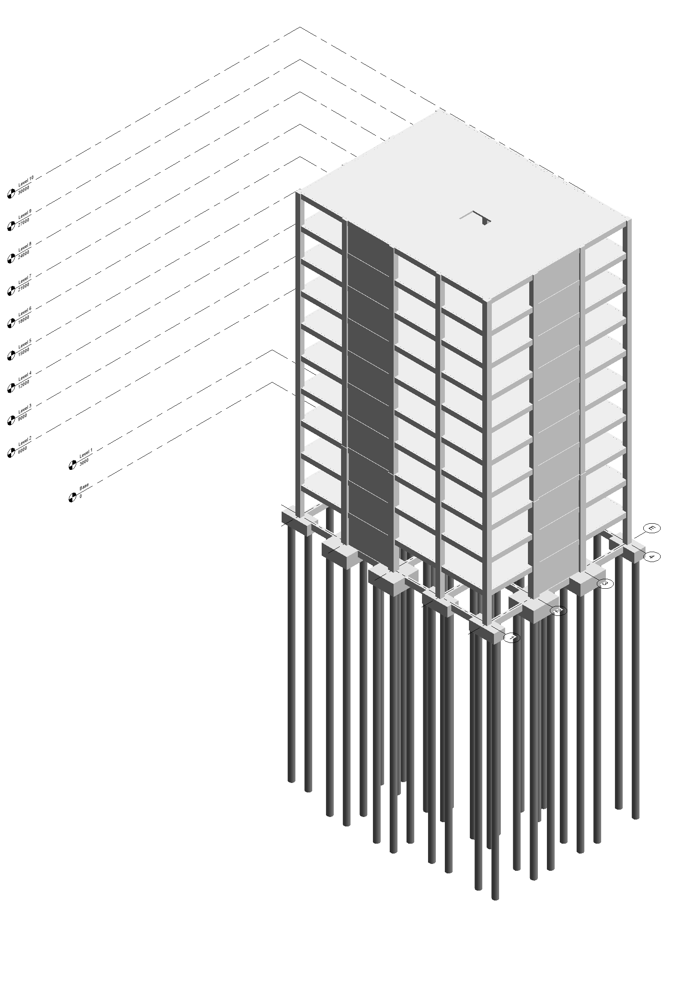
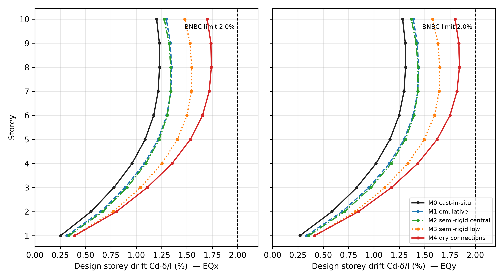
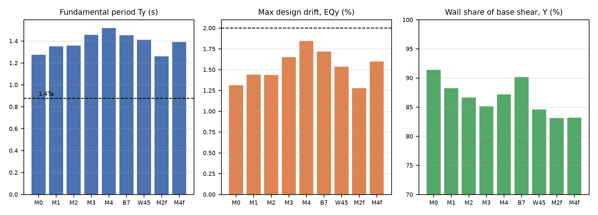

# Seismic response of a precast RC frame–wall residential building under BNBC 2020 seismic design parameters: comparison with a cast-in-situ reference and sensitivity to connection stiffness

## Authors

Shahjahlal Ahmed Sifat, Golam Kuadir Khan Prince, and Md. Sifat Ul Islam  
Hajee Mohammad Danesh Science and Technology University, Dinajpur, Bangladesh

## Abstract

This study compares the linear response of a ten-storey reinforced-concrete (RC) frame–wall residential building using Bangladesh National Building Code 2020 (BNBC 2020) seismic design parameters in a cast-in-situ reference and idealised precast forms. It comprises three distinct ETABS analyses. Analysis 1 establishes the cast-in-situ reference after correcting an earlier off-centre wall layout and adding partition loads to the seismic mass. The final reference has a seismic weight of 44,431 kN, an ELF base shear of 3,044 kN, a fundamental period of approximately 1.27 s and a BNBC centre-of-mass design drift of 1.20% (with a conservative maximum-point drift of 1.31%), well below the 2.0% limit. Analysis 2 derives precast variants from that reference by assigning linear rotational springs to beam ends and reduced in-plane membrane stiffness to wall panels. Design storey drift is evaluated per BNBC Sec 2.5.7.7 at the centre of mass as the primary compliance metric, alongside maximum-point drift incorporating edge torsion. Across the principal precast variants, the centre-of-mass Y-direction design drift increases from 1.32% for emulative (M1) and 1.31% for central semi-rigid (M2) cases to 1.69% for the dry-connection case (M4), while conservative maximum-point drifts range from 1.44% to 1.84%, torsion ratios remain 1.09–1.10 and walls retain 85–91% of base shear. Member checks identify the eight wall-end columns—which share nodes with the wall shells and act as integral boundary elements of the special walls—as a key sensitivity: joint flexibility concentrates overturning axial demand into these boundary elements, requiring detailing per ACI 318-19 §18.10.6 (special boundary elements are required in storeys 1–5/6). In the M4 dry case, this causes 24 overstressed column stations and a maximum required longitudinal ratio of 7.1% under the frame-design proxy. Enlarging the wall boundary columns from 500×500 mm to 600×600 mm in the lowest three storeys reduces M4 centre-of-mass drift to 1.47% (maximum-point drift to 1.60%) and eliminates reported column overstress. Analysis 3 introduces preliminary bored-pile foundations (600 mm diameter × 24 m) and evaluates soil–structure interaction (SSI) sensitivity across stiff, central and soft pile springs. Foundation flexibility is first-order on this soft site: wall pile-cap rocking lengthens the period to 1.66–2.28 s and increases centre-of-mass drift to 1.64% (stiff), 1.97% (central, near the 2.0% limit), and 2.48% (soft, exceeding the limit), while the walls' base shear share falls from 91% to 42–70%. On central springs, the recommended precast model behaves virtually identically to the monolithic building (1.91% vs 1.97% drift). In addition, wall-end pile caps experience pile uplift (~440–500 kN), requiring precast column-to-cap tension ties per BNBC 6.10.5.1.3(a). Superstructure connection flexibility is secondary to foundation flexibility on this soft site; precast frame–wall construction is viable provided wall boundary columns and wall foundations are designed for the redistributed overturning.

## Keywords

Precast reinforced concrete; seismic response; BNBC 2020; building-frame system; shear wall; connection stiffness; ETABS; Bangladesh

## 1. Introduction

Bangladesh’s housing demand and construction activity make construction systems that can be produced repeatedly and installed with predictable quality relevant to practice. Precast reinforced concrete (RCC) relocates some fabrication from the construction site to a production facility. Its structural performance, however, depends on the continuity of force transfer through member connections, panel joints, diaphragms and foundations. These interfaces are especially consequential in regions where earthquake design governs lateral resistance. The Bangladesh National Building Code 2020 (BNBC 2020; Ministry of Housing and Public Works [MHPW], 2021) recognises precast construction and specifies structural integrity and connection provisions, but local project teams still need building-specific evidence about how realistic connection flexibility affects global response and member demand.

The companion pre-feasibility study by Sifat et al. (n.d.), hereafter Paper 1, examined regulatory, economic, logistical and institutional conditions for precast RCC in Bangladesh. Its conclusion was that project implementation depends on connection evidence and an auditable route for design, analysis or testing. Paper 1 did not analyse a representative building’s structural response. The present paper addresses that linked but distinct engineering question. It treats the same ten-storey residential archetype as a structural case study and asks: how does a precast RC frame–wall building designed under BNBC 2020 compare with an equivalent cast-in-situ RC building, and how sensitive is its response to idealised precast connection stiffness?

The technical issue is not simply whether a precast model can be assigned the same response modification factor as a monolithic model. A building-frame system with special RC shear walls relies primarily on walls for seismic resistance; its gravity frame must remain capable of supporting gravity loads at the design displacement. Precast beam–column and wall-panel joints may nevertheless change stiffness, deformation compatibility, force transfer and the axial demand in boundary elements. A rigid-joint assumption can therefore obscure response changes even when the wall layout, mass and design spectrum are held constant. The comparison must state which properties are changed, how they are represented, and where modelling assumptions limit the conclusions.

The analyses were structured in three stages. Analysis 1 is the cast-in-situ reference building, modelled with four point-symmetric perimeter walls and a final seismic weight that includes partitions. Analysis 2 derives precast variants from the reference. Beam-end rotational springs represent semi-rigid connection restraint; reduced membrane stiffness represents the in-plane effect of wall bed-joint compliance. The study compares global periods, design drifts (evaluated both at the centre of mass per BNBC Sec 2.5.7.7 and at maximum-displacement floor perimeter points), response-spectrum-to-equivalent-static base-shear ratios, wall share of base shear and torsional response. It also reports ETABS frame design checks using ACI 318-19 as a proxy for BNBC concrete design and separate wall hand checks. Analysis 3 incorporates a preliminary deep bored-pile foundation and investigates soil–structure interaction (SSI) sensitivity across stiff, central and soft pile-group spring stiffnesses, quantifying the effects of wall pile-cap rocking and force redistribution between walls and frames.

Four contributions follow. First, the paper documents why the original model required correction before a precast comparison could be meaningful. Second, it compares a regular cast-in-situ reference with a matrix of precast connection idealisations, including one-factor cases that isolate beam-joint and wall-joint stiffness changes. Third, it identifies a member-level consequence in the model: the eight wall-end columns share nodes with the wall shells and act as integral boundary elements of the special walls, where joint flexibility concentrates overturning axial demand that must be addressed under ACI 318-19 §18.10.6. A remedial model enlarging the wall boundary columns to 600×600 mm in the lowest three storeys is reported as a design sensitivity, not as a universal prescriptive solution. Fourth, it evaluates substructure demands and soil–structure interaction (SSI) under bored-pile foundations, demonstrating the dominance of wall-cap rocking over superstructure joint flexibility on soft soils and identifying tensile tie requirements under BNBC 6.10.5.1.3(a).

The analyses are linear and use literature-based stiffness values. The paper reports elastic response differences and preliminary member demands only; it does not establish cyclic or nonlinear performance, experimental validation, full member-level design compliance, collapse safety or approval of a connection.

## 2. Background

### 2.1 BNBC 2020 seismic design context

BNBC 2020 assigns Dhaka to Seismic Zone 2 with a zone coefficient of \(Z = 0.20\) (MHPW, 2021, Part 6, Chapter 2, Tables 6.2.14 and 6.2.15). Design spectra depend on the site class and period (Table 6.2.16); the seismic response parameters also depend on occupancy category and structural system. For the adopted residential occupancy, Occupancy Category II and importance factor \(I=1.0\) are used (Table 6.2.17). With the site assigned to SD (Table 6.2.13) and the zone and occupancy inputs adopted in the model, the building is in Seismic Design Category D (Table 6.2.18). The selected lateral-force-resisting system is a building-frame system with special RC shear walls. The model uses response modification factor \(R=6\), overstrength factor \(\Omega_0=2.5\), deflection amplification factor \(C_d=5\) and a 50 m height limit for the listed system in SDC D (MHPW, 2021, Part 6, Chapter 2, Table 6.2.19).

The system classification matters for interpreting frame demand. The walls are the designated seismic-force-resisting elements. The perimeter and interior frames provide gravity support and also contribute stiffness in the analytical model, but the building is not classified as a dual system in this study. The same \(R\), \(I\), and \(C_d\) values were retained for the precast cases as an emulative special-wall design assumption. That assumption is a design premise for comparative elastic analysis; the spring values alone do not qualify a connection or demonstrate compliance with all detailing provisions.

BNBC requires the design period used for equivalent lateral force (ELF) calculation to be limited in the manner prescribed by its seismic provisions. For the adopted “all other systems” approximate-period relation, \(T_a=C_t h_n^{m} = 0.0488h_n^{0.75}\) (Part 6, Chapter 2, Sec 2.5.7.2(b), Eq. 6.2.38, with \(C_t = 0.0488\) and \(m = 0.75\) from Table 6.2.20). At a building height of \(h_n = 30\) m, the reported value is 0.626 s. Under Sec 2.5.7.2(a), which limits the analytical period to 1.4 times the Eq. 6.2.38 value, the model’s ELF period is capped at \(1.4T_a=0.876\) s. The final modal period is longer, approximately 1.27 s in the cast-in-situ reference, so this cap governs the ELF coefficient. The baseline model uses \(C=0.0685\) at the capped period. At \(T_a\), the BNBC plateau coefficient reported in the initial code review is \(C_s=2.5S=3.375\), corresponding to \(S_a=0.075\) for \(Z=0.20\), \(I=1.0\) and \(R=6\). These quantities refer to different period points and should not be conflated.

The analysis also follows code checks for accidental torsion, dynamic-analysis adequacy, modal mass participation, drift and P–Δ stability. A 5% accidental eccentricity is included. Design storey drift is defined by BNBC 2020 Part 6, Chapter 2, Sec 2.5.7.7 from deflections at the centre of mass (\(\delta_x = C_d\delta_{xe}/I\)) and compared with the 2.0% limit for Occupancy II (Part 6, Chapter 2, Table 6.2.21). The P–Δ stability coefficient is checked against the limit \(\theta \le 0.10\) (Chapter 2, Sec 2.5.7.9). Response-spectrum forces are checked against the prescribed minimum fraction of ELF base shear and scaled to at least 85% of ELF base shear where needed (Chapter 2, Sec 2.5.9.4). Because the reference building has a long period relative to \(T_a\), and because the original layout exhibited severe torsional irregularity, response-spectrum analysis was retained alongside ELF for the final model.

### 2.2 BNBC provisions for precast construction

Part 6, Chapter 6, Section 6.10 of BNBC 2020 addresses precast concrete construction. Section 6.10.5 sets structural-integrity requirements. Section 6.10.5.1.2 requires diaphragm-to-supported-member connections to provide at least 4.4 kN per linear metre. Section 6.10.5.1.3 specifies a minimum nominal tensile strength of \(1.4A_g\) N for precast columns and at least two ties per precast wall panel, each with a minimum strength of 44 kN. Section 6.10.5.1.4 excludes connection details that rely solely on friction caused by gravity loads. For precast bearing-wall structures three or more storeys in height, Section 6.10.5.2 specifies longitudinal and transverse floor/roof ties of 22 kN/m, longitudinal ties at no more than 3 m centres, transverse ties at no more than the bearing-wall spacing, and perimeter ties within 1.2 m of the edge with a minimum strength of 71 kN. Section 6.10.5.2.5 further requires vertical ties continuous over the building height, with a minimum capacity of 44 kN per horizontal metre of wall and at least two ties per panel. Section 6.10.6.1.1 states that connection adequacy for force transfer between members is to be established by analysis or test (MHPW, 2021).

The 22 kN/m floor/roof ties and the 44 kN/m vertical ties are stated in the subsection for precast bearing-wall structures. Since the archetype is classified here as a building-frame system with special shear walls, their direct prescriptive applicability to every connection in this model requires project-level code interpretation. The values are reported below as integrity benchmarks, and no claim is made that the full bearing-wall tie schedule automatically governs this system. The general requirements of Section 6.10.5.1, including at least two 44 kN ties per precast wall panel, apply to all precast structures.

These provisions establish minimum force-transfer and integrity expectations. They do not, by themselves, supply the stiffness of a particular corbel, grouted sleeve, bearing, weld or bed joint. A structural model must use connection properties appropriate to the selected detail or explicitly treat them as uncertain parameters. Similarly, a minimum tie capacity is an integrity floor. It does not replace design of reinforcement and splices for the tensile and cyclic demands required by the actual wall mechanism. The distinction is important for a frame–wall building: the elastic wall-edge stress is informative about potential flexural demand, but the final connection design requires a compatible force and reinforcement detail.

### 2.3 ACI 318-19 seismic options for precast systems

ACI 318-19 Chapter 18 provides seismic detailing routes that are relevant to precast systems. Section 18.9 covers special moment frames constructed using precast concrete. Section 18.9.2 addresses ductile connections, for which the connection region is intended to undergo inelastic response and requires qualification through structural testing. Section 18.9.3 addresses strong connections, where the connection remains essentially elastic while yielding is intended to occur in designated member regions. The supplied connection review gives the strong-connection strength condition as a design strength \(\phi S_n\geq1.4S_e\), or development of at least \(1.25f_y\) in the longitudinal reinforcement. Emulative wet joints fall within this design philosophy only when the required strength and detailing conditions are met (American Concrete Institute [ACI], 2019).

Section 18.11 concerns special structural walls constructed using precast concrete and directs their design and detailing to the applicable special-wall requirements, including those in Section 18.10. Horizontal panel joints and vertical reinforcement continuity are consequently central to any emulative precast-wall scheme. Type 2 mechanical splices under Section 18.2.7 are one route identified in the supplied review for developing both the specified bar tensile strength \(f_u\) and at least \(1.25f_y\) across joints. Grouted sleeves can be used in such a role only when their qualification, installation and design satisfy the relevant requirements. The analytical wall modifier used here does not model sleeve force–slip response and cannot establish splice qualification.

These ACI provisions are used to frame design options and as a reference for the ETABS concrete-frame design proxy. The study does not identify the modelled semi-rigid frame joints as an ACI special moment frame. Under the adopted building-frame system, the special walls provide the defined lateral-force-resisting mechanism, while the gravity frame must remain adequate at the design displacement. If a project instead relies on the frame as part of a special moment frame or dual system, different qualification and design requirements apply. The response factor used in a project must follow the approved structural system and applicable code requirements.

### 2.4 Connection stiffness and analytical representation

Precast beam–column connections exhibit a range of rotational restraint depending on their geometry, bearing, dowels, continuity reinforcement, grouting, topping and mechanical details. Monforton and Wu (1963) formulated a classical fixity factor for semi-rigid frame analysis. Later experimental and analytical work on precast frames examined the relationship between connection stiffness and frame response, including semi-rigid beam–column behaviour (Elliott et al., 2003a, 2003b; Ferreira et al., 2003). Research on corbel interfaces has shown that vertical grouting and continuity details affect connection behaviour (Lacerda et al., 2018), while later work has evaluated rotational stiffness and connection response through experimental and numerical approaches (Hashim & Agarwal, 2018; Moreira et al., 2024; Silva et al., 2021). These studies support treating joint stiffness as a response parameter. Their connection geometries and concrete, reinforcement and construction details do not establish the stiffness of the Bangladesh archetype directly.

For the beam springs, the model uses the fixity factor

\[
\gamma = \frac{1}{1+3E_cI_{\mathrm{eff}}/(R_kL)},
\]

where \(R_k\) is the rotational spring stiffness, \(E_cI_{\mathrm{eff}}\) is the effective flexural rigidity of the connected beam, and \(L\) is its span. This expression is rearranged to select idealised stiffness levels corresponding to rigid, central semi-rigid, lower semi-rigid and dry-connection cases. The selected values are drawn from the literature-based connection parameter compilation in the project files. They are secant-style linear representations for comparative modelling. Actual connections have nonlinear moment–rotation histories and may exhibit slip, gap opening, yielding, strength limits and cyclic degradation that this equation does not represent.

Precast wall-panel joints also affect in-plane flexure and shear transfer. Experimental and analytical studies of grouted sleeves, horizontal joints and emulative precast walls report that panel response depends on the connection, splice and interface detailing (Han et al., 2019; Peng et al., 2016; Seifi et al., 2016, 2017; Soudki et al., 1995a, 1995b; Xu et al., 2017; Zhu & Guo, 2018). The present study maps this evidence to a reduced membrane stiffness modifier for the wall shells. It does not simulate discrete bed-joint links or local bond and interface mechanisms. The modifier is an effective macro-level idealisation, with out-of-plane shell bending retained separately.

The literature therefore supports a sensitivity study but not direct transfer of a single “typical” stiffness to every connection. fib Bulletin 43 discusses connection force mechanisms and the need to develop connection behaviour for the specific structural use; it does not supply a universally applicable rotational spring for this building (Fédération internationale du béton, 2008). The parameters used below are consequently interpreted as a bounded modelling matrix. A future local programme should test selected connection details and update the analytical stiffness ranges from measured response.

## 3. Building, site and code parameters

### 3.1 Building archetype and geometry

The model represents a ten-storey residential building with a 20 m × 15 m rectangular plan and a 5 m grid in both principal directions. Storey height is 3 m, giving a total modelled height of 30 m. The principal frame members comprise 500×500 mm columns and 300×500 mm beams. The floor slab thickness is 150 mm. Concrete is C28 and reinforcement is Grade 60 steel. These dimensions and materials are held constant between the cast-in-situ reference and the standard precast variants, except where the explicitly reported wall boundary-column modification is applied.

Analysis 1 uses four 5 m-long, 200 mm-thick perimeter structural walls. Two walls are oriented in each principal direction and arranged point-symmetrically about the plan centre at (10 m, 7.5 m). The layout is intended to reduce stiffness-centre eccentricity and preserve a regular plan response. Analysis 2 inherits this wall arrangement and the same floor and frame geometry. The BIM view in Figure 1 illustrates the archetype and the relationship between the frame and wall elements; it is a building illustration rather than an ETABS result plot.

### 3.2 Gravity loads and seismic mass

The model includes self-weight, floor-finish and partition loads, with partitions represented as line loads on beams in the project model. The residential live load is 2.0 kN/m². The seismic mass source includes the applicable dead-load components and 25% of live load, consistent with the adopted BNBC mass-source treatment. The final cast-in-situ seismic weight is 44,431 kN. The same gravity loading and mass definition are retained for the standard precast variants. Strength design combinations are assigned from BNBC 2020 Part 6, Chapter 2, Sec 2.7.3.1 (specifically combinations 5 and 7, \(1.2D + 1.0E + 1.0L\) and \(0.9D \pm 1.0E\), which govern lateral overturning and uplift). The original preliminary model did not include partitions in the seismic mass; that omission and its later correction are discussed in Section 4.1.

### 3.3 Site investigation and adopted site class

The geotechnical input is the site investigation for Plot 4356, Road 23, Block N, Bashundhara Residential Area, Dhaka. It reports five boreholes, each extending to approximately 30.5 m, with groundwater at ground level. Geotechnical evaluation reveals a thickness-weighted harmonic mean of measured field SPT blow counts over the top 30 m, N̄30 = 3.5–4.7 across five boreholes (site mean ≈ 4.0). The upper approximately 6.7 m is described as loose sand and miscellaneous fill, with reported SPT values of 1–7. Underlying strata include very soft to soft clayey silt, medium-stiff to stiff clay and dense to very dense sand at depth (MEGHLA Soil & Foundation, n.d.). To support a multi-storey building on this profile, the geotechnical report recommends deep foundations consisting of bored cast-in-situ piles approximately 21–24 m long embedded into the dense sand stratum.

The adopted code baseline is Site Class SD under BNBC 2020 Part 6, Chapter 2, Table 6.2.13. An earlier site-data label of SE is superseded by the correction at the end of the soil transcription. The site investigation does not include the plasticity-index data needed to establish whether the soft cohesive layer meets the S1 criterion. The loose, saturated fill and groundwater at ground level also leave a liquefaction question. S1 and S2 are therefore not excluded. The analyses use the SD spectrum as the code baseline and do not include a site-specific S1/S2 spectrum or liquefaction-triggered ground deformation.

### 3.4 BNBC seismic parameters used in the models

Table 1 summarizes the seismic design parameters and model inputs adopted in this study under BNBC 2020 (MHPW, 2021).

Table 1. BNBC 2020 seismic design parameters and model inputs adopted for the ten-storey residential building.

| Parameter | Adopted value | Basis or model use |
|---|---:|---|
| Location and seismic zone | Dhaka, Zone 2 | Chapter 2, Tables 6.2.14 and 6.2.15 |
| Zone coefficient, \(Z\) | 0.20 | Chapter 2, Table 6.2.15 |
| Site class | SD | Chapter 2, Table 6.2.13; S1/S2 not excluded |
| Site factor, \(S\) | 1.35 | Chapter 2, Table 6.2.16, SD |
| Spectrum periods, \(T_B,T_C,T_D\) | 0.20 s, 0.80 s, 2.0 s | Chapter 2, Table 6.2.16, SD |
| Occupancy category / importance, \(I\) | II / 1.0 | Residential; Chapter 2, Table 6.2.17 |
| Seismic design category | D | Chapter 2, Table 6.2.18 |
| Structural system | Building frame with special RC shear walls | Chapter 2, Table 6.2.19 |
| Response modification factor, \(R\) | 6 | Chapter 2, Table 6.2.19 |
| Overstrength factor, \(\Omega_0\) | 2.5 | Chapter 2, Table 6.2.19 |
| Deflection amplification, \(C_d\) | 5 | Chapter 2, Table 6.2.19 |
| Height limit | 50 m | Chapter 2, Table 6.2.19, SDC D |
| Approximate period, \(T_a\) | 0.626 s | Chapter 2, Sec 2.5.7.2(b), Eq. 6.2.38, Table 6.2.20 |
| ELF period cap | \(1.4T_a=0.876\) s | Chapter 2, Sec 2.5.7.2(a) |
| ELF coefficient, \(C\) | 0.0685 | \(S_a\) at capped ELF period |
| Seismic weight, \(W\) | 44,431 kN | Final model with partitions |
| ELF base shear, \(V_{\mathrm{ELF}}\) | 3,044 kN | \(C W\), reported final value |
| Design drift limit | 2.0% | Occupancy II, Chapter 2, Table 6.2.21 |
| Accidental eccentricity | ±5% | Applied in ELF and RSA cases |
| Response-spectrum scaling | Forces to at least 85% of \(V_{\mathrm{ELF}}\) | Chapter 2, Sec 2.5.9.4 |
| P–Δ stability coefficient limit | 0.10 | Chapter 2, Sec 2.5.7.9 (\(\theta \le 0.10\)) |

At the capped period the model uses \(C=0.0685\), which gives the reported \(V_{\mathrm{ELF}}=3{,}044\) kN for the final seismic weight. The model also reports a separate spectrum plateau value at \(T_a\), as described in Section 2.1. This distinction is retained because the period used for ELF base-shear calculation is capped while the modal period from the analytical model is longer.

## 4. Methodology

### 4.1 Preliminary model review and layout correction

The starting ETABS model was the repository model ETABS/4.EDB, run through the ETABS API using ETABS 22.5. Its geometry comprised ten storeys at 3 m, 20 columns of 500×500 mm per storey, 300×500 mm beams, 150 mm slabs and three 200 mm walls grouped as a U-shaped core. The three walls had 15 m total length and were clustered away from the centre of the 20 m × 15 m plan. Although the model carried a precast material label, it had no link elements and no frame-end releases: all beam–column joints behaved monolithically. It was therefore structurally a cast-in-situ model, not a model of precast connections.

The preliminary seismic input also required revision. The model used a user coefficient \(C=0.056\), a 5% eccentricity and a seismic weight of 29,010 kN, producing a base shear of 1,624.6 kN. The response-spectrum function was a placeholder rather than the BNBC SD design spectrum. The partition load was absent from the seismic mass. The design combinations exported with the model included ETABS/ASCE-style combinations rather than the BNBC strength combinations used in the final study. The model review showed that this input could not support a code-based comparison of precast and cast-in-situ systems.

The layout was also strongly torsionally irregular. The reported maximum-to-average displacement ratios were 1.67–1.86 under EQx and 1.75–2.47 under EQy, exceeding the BNBC thresholds of 1.2 for torsional irregularity and 1.4 for extreme torsional irregularity. The first mode was predominantly torsional, with a reported period of 1.878 s. The preliminary coefficient \(C=0.056\) was below the reviewed BNBC design coefficient; the code review calculated approximately 0.075 at \(T_a\), while the final capped-period procedure gives 0.0685. The preliminary maximum elastic drift was 0.0027. Scaling that result to the reviewed design shear and multiplying by \(C_d=5\) gave an estimated design drift of about 1.8%, before torsional amplification. This estimate did not remedy the irregularity or seismic-input deficiencies.

The off-centre U-core was replaced by four 5 m × 200 mm perimeter walls, two in each direction and point-symmetric about (10 m, 7.5 m). The change increased the total wall length from 15 m to 20 m while improving the stiffness balance. The final reference added partition loads to the mass source, assigned the BNBC SD spectrum, applied the capped-period ELF procedure, used 30 response-spectrum modes, and applied BNBC strength combinations. This redesign produced a regular cast-in-situ model for Analysis 1 and a consistent source model for Analysis 2.

The first redesign record in baseline_review.md reports intermediate values from before the final partition-mass update, including \(W\approx29{,}680\) kN, \(V_{\mathrm{ELF}}=2{,}034\) kN and periods near 1.03–1.04 s. Those values are retained here only to document model development. Final Analysis 1 results are taken from the 1_CastInSitu README and results_summary.md: \(W=44{,}431\) kN, \(V_{\mathrm{ELF}}=3{,}044\) kN, \(T\approx1.27\) s, BNBC centre-of-mass design drift of 1.20% in Y (1.18% in X), and maximum-point design drift of 1.31% in Y (1.23% in X).

Table 2 summarizes the structural attributes, seismic inputs, and global response parameters between the preliminary model and the corrected Analysis 1 reference.

Table 2. Comparison of key structural attributes, seismic inputs, and global response between the preliminary model and the corrected Analysis 1 cast-in-situ reference.

| Check | Original preliminary model | Final corrected Analysis 1 model |
|---|---|---|
| Wall arrangement | Three off-centre U-core walls, 15 m total | Four perimeter walls, 20 m total, point-symmetric |
| Connection representation | Monolithic beam–column joints; no links or releases | Monolithic cast-in-situ frame for reference |
| Partition mass | Omitted | Included |
| Seismic input | \(C=0.056\); placeholder response spectrum | BNBC SD spectrum; \(C=0.0685\) at capped ELF period |
| Seismic weight, \(W\) | 29,010 kN | 44,431 kN |
| ELF base shear | 1,624.6 kN | 3,044 kN |
| Fundamental response | \(T_1=1.878\) s; first mode torsional | \(T_x=T_y\approx1.27\) s; translational modes first |
| Torsion ratio | EQx 1.67–1.86; EQy 1.75–2.47 | 1.04 (X); 1.10 (Y) |
| Drift | Preliminary estimate about 1.8% after shear and \(C_d\) scaling; torsion not resolved | 1.18% / 1.20% (CM X/Y); 1.23% / 1.31% (max-point X/Y), against 2.0% |

### 4.2 Analysis 1: cast-in-situ reference model

Analysis 1 is the final monolithic cast-in-situ building, designated M0 in the comparative results. It was developed from the corrected layout and modelled with rigid beam–column joints. The reference building retains the 500×500 mm columns, 300×500 mm beams, 150 mm slabs, C28 concrete, Grade 60 reinforcement and four perimeter walls. Cracked-section modifiers reported for the model are 0.70 for columns and walls, 0.35 for beams and 0.25 for slab bending. One rigid diaphragm is assigned at each floor, and the base is fixed. These assumptions provide the common structural reference for the sensitivity analyses.

The mass source includes self-weight, floor-finish and partition loads, with 25% of live load. The final model’s seismic weight is 44,431 kN. The ELF case uses \(C=0.0685\), the \(1.4T_a=0.876\) s cap, \(k=1.19\), and ±5% accidental eccentricity. The resulting design base shear is 3,044 kN. The response-spectrum cases use the BNBC SD design spectrum with CQC/SRSS modal combination and 5% eccentricity. Thirty modes were used, and the response-spectrum forces were scaled to the required 85% minimum relative to ELF (scale factors of 1.63 in X and 1.64 in Y per BNBC Chapter 2, Sec 2.5.9.4; see Section 5.2).

Model checks reported for M0 include translational modes first, more than 99% participating mass in the two principal directions, torsion ratios of 1.04 in X and 1.10 in Y, and a maximum P–Δ coefficient not exceeding 0.03 (checked against the BNBC limit \(\theta \le 0.10\) per Chapter 2, Sec 2.5.7.9). Evaluated at the centre of mass per BNBC Sec 2.5.7.7, the design drifts are 1.18% in X and 1.20% in Y; the conservative maximum-point design drifts across the diaphragm are 1.23% in X and 1.31% in Y. Frame design was run in ETABS using ACI 318-19, treated as a proxy for BNBC Part 6 concrete design. Walls were checked separately using the project hand-check procedure. These checks support comparison and preliminary design evaluation; they do not constitute a complete independent BNBC permit review.

### 4.3 Analysis 2: precast connection models and variant matrix

Analysis 2 comprises precast variants derived from the M0 cast-in-situ model. Geometry, gravity loads, mass assumptions, seismic inputs, diaphragm constraints, support conditions and response factors are held constant for the principal variants. The beam–column joint is represented by rotational partial-fixity springs about the beam major bending axis at both ends. The spring value \(R_k\) is selected using the fixity factor \(\gamma\) described in Section 2.4. A rigid beam end corresponds to the monolithic limit; finite spring values idealise semi-rigid beam–column restraint.

Horizontal wall-panel bed-joint effects are represented by reducing the in-plane shell membrane stiffness modifiers \(f_{11}\), \(f_{22}\) and \(f_{12}\). Smeared uniform membrane modifiers are an equivalent secant-stiffness idealisation for global drift screening and cannot capture discrete bed-joint opening, rocking or shear slip (Pekau & Hum, 1991; Seifi et al., 2017). Out-of-plane bending modifiers remain at 0.70 in the wall parameter specification. As a result, the model can compare global in-plane response under equivalent effective stiffness assumptions but cannot resolve local bed-joint stresses or force–slip behaviour.

The study’s principal variants include M1–M4, while B7 and W45 isolate the two connection families as one-factor cases. M1 represents rigid beam joints with a 0.65 wall membrane modifier. M2 uses a central semi-rigid beam spring, \(R_k=30{,}000\) kN·m/rad, with \(\gamma\approx0.65\), and wall modifier 0.56. M3 uses \(R_k=16{,}321\) kN·m/rad, \(\gamma=0.50\), and wall modifier 0.45. M4 uses \(R_k=7{,}000\) kN·m/rad, \(\gamma\approx0.30\), and wall modifier 0.50. B7 applies the 7,000 kN·m/rad beam spring with wall modifier 0.70; W45 retains rigid beam joints and applies wall modifier 0.45. M0 is the cast-in-situ comparator with rigid joints and wall modifier 0.70.

Table 3 details the matrix of precast connection variants, spring stiffnesses, fixity factors, and wall membrane modifiers.

Table 3. Matrix of precast connection variants, spring stiffnesses, fixity factors, and wall membrane stiffness modifiers.

| Variant | Beam-end spring \(R_k\) (kN·m/rad) | Fixity factor \(\gamma\) | Wall membrane modifier | Model purpose |
|---|---:|---:|---:|---|
| M0 | Rigid | 1.00 | 0.70 | Cast-in-situ reference |
| M1 | Rigid | 1.00 | 0.65 | Emulative precast idealisation |
| M2 | 30,000 | ≈0.65 | 0.56 | Central semi-rigid case |
| M3 | 16,321 | 0.50 | 0.45 | Lower semi-rigid sensitivity |
| M4 | 7,000 | ≈0.30 | 0.50 | Dry mechanical connection sensitivity |
| B7 | 7,000 | ≈0.30 | 0.70 | Beam-joint flexibility only |
| W45 | Rigid | 1.00 | 0.45 | Wall-joint flexibility only |

The one-factor comparison is M0 against B7 for beam-joint flexibility and M0 against W45 for wall stiffness reduction. These comparisons help separate the relative influence of the two idealised components. Because W45 adopts a wall modifier of 0.45 whereas M4 uses 0.50 (combined with \(R_k = 7{,}000\) kN·m/rad), B7 and W45 provide indicative sensitivity benchmarks rather than an exact mathematical decomposition of M4, and no claim of additive response is made. A semi-rigid diaphragm model appears in the connection research file as a proposed M5 variant, but it was not part of the analysed matrix and is not reported as a result here.

### 4.4 Analysis procedures: ELF, response spectrum, torsion and P–Δ

Each model was assessed with ELF and response-spectrum procedures. BNBC Sec 2.5.8.1 requires dynamic analysis for regular buildings taller than 40 m in Zones 2–4 or irregular buildings taller than 12 m. The corrected 30 m regular building may therefore be designed by the equivalent static force method, with RSA reported as a supplementary check; the original irregular 30 m layout would have required dynamic analysis.

ELF loads use the common capped-period coefficient and design base shear. The response-spectrum function is the BNBC 2020 SD spectrum, applied separately in X and Y with 5% accidental eccentricity. Thirty modes were included, with CQC or SRSS modal combination as specified in the model. The unscaled response-spectrum base shear is reported relative to ELF. Where the ratio was below 0.85, response-spectrum force results were scaled to at least 85% of the corresponding ELF base shear for design-force use per BNBC Chapter 2, Sec 2.5.9.4.

The period reported in the global response table is the fundamental translational period in each direction. BNBC 2020 Part 6, Chapter 2, Sec 2.5.7.7 defines design storey drift from deflections at the centre of mass (\(\delta_x = C_d \delta_{xe} / I\)). Accordingly, this paper now reports both the BNBC centre-of-mass drift (primary metric, evaluated against the 2.0% limit for Occupancy II per Table 6.2.21) and the maximum-point drift across the floor diaphragm. The maximum-point drift captures torsional amplification at the plan extremities and serves as a conservative upper bound. Story drifts are obtained from ELF analysis including ±5% accidental eccentricity and amplified by \(C_d/I = 5.0/1.0 = 5.0\). For foundation-flexibility models, the rigid-body base translation is subtracted so that the drift reflects superstructure inter-storey distortion alone. The response-spectrum base-shear ratio and the ELF design-drift values are reported as separate quantities. This distinction avoids interpreting the unscaled response-spectrum ratio as the force level used for member checks.

Torsion is reported as the maximum-to-average edge displacement or drift ratio in the relevant direction. The final model’s ratios remain below 1.2; the original layout exceeded the torsional and extreme torsional thresholds. P–Δ stability was checked through the storey stability coefficient. The final cast-in-situ model reports \(\theta\leq0.03\), well below the BNBC limit of \(\theta \le 0.10\) (Chapter 2, Sec 2.5.7.9). The results summary does not provide a separate P–Δ coefficient for each precast variant; the comparative conclusions therefore do not infer variant-specific stability values beyond the reported global checks.

### 4.5 Frame and wall member checks

ETABS concrete frame design used ACI 318-19 as a proxy for BNBC Part 6 concrete design. The exported frame tables provide column longitudinal reinforcement ratios and overstressed column-station counts, beam reinforcement ratios and joint-shear demand/capacity ratios. ACI 318-19 is a proxy in this paper because the project files report that design basis; BNBC concrete-member design was not independently implemented in a separate code engine. The ACI output should therefore be interpreted as a comparative screening check, not as a declaration of complete BNBC compliance.

Wall checks were performed separately using exported pier forces and the project’s wall-check procedure. Reported quantities include wall shear demand/capacity, required longitudinal reinforcement ratio, special-boundary-element storeys and peak wall-edge stress. The hand checks indicate where wall boundary elements are required in the model and how those demands vary between variants. Because the model uses shell membrane modifiers rather than discrete connection elements, the wall checks do not supply connection-component capacities or demonstrate that a particular grouted sleeve, bed joint or anchorage detail will transfer the resulting force.

Precast wall continuity was considered against the BNBC minimum ties (two 44 kN ties per panel, Chapter 6, Section 6.10.5.1.3(b); 44 kN per horizontal metre for bearing-wall structures, Section 6.10.5.2.5) and the ACI special-wall provisions. The minimum tie is compared with the reported elastic wall-edge tension only as a scale comparison. Actual detailing must carry the force demand associated with the wall’s flexural reinforcement and must satisfy the relevant splice, anchorage and connection provisions. The reported stress-derived comparison does not replace a bar-force calculation or connection design.

### 4.6 ETABS automation and reproducibility

Model updates and result exports used the ETABS API scripts in Paper2_Structural/scripts. They prepare the baseline, generate precast variants, run analyses, extract tables, execute checks, summarise member design, plot results and apply the wall boundary-column modification. Each precast model is generated from M0 so that geometry, loads and assignments remain consistent.

Model-specific ETABS tables retain periods, mass participation, drifts, forces, reactions, pier demands and design results. The consolidated results_summary.md and variant_comparison.json provide the values reported here. Reproduction requires the saved ETABS models, scripts, ETABS version, model units, load assignments, modifiers, combinations and analysis settings. Automation does not validate connection properties or code interpretation.

### 4.7 Substructure and soil–structure interaction (Analysis 3)

To examine foundation compliance on the soft estuarine profile described in Section 3.3, Analysis 3 replaces the idealized fixed-base supports with pile-group springs and includes ground-level tie (grade) beams. Sizing of the preliminary bored-pile foundation was performed using `scripts/pile_design.py` based on exported column base reactions for the recommended precast scheme (M2 with 600×600 mm boundary columns, exported from ETABS as `reactions_M2_fix600/Joint Reactions.csv`). This is an allowable-stress design (ASD) preliminary sizing for coordination and soil–structure interaction sensitivity, not a detailed construction design.

The pile design basis adopts 600 mm-diameter bored cast-in-situ piles with an embedment length of 24 m, founded in the dense fine sand layer (SPT \(N = 38\)–145 below approximately 20 m). Soil report Section 3.7 lists skin friction values of 1,307–1,548 kN across boreholes BH-1 to BH-5; the lower bound is adopted as the allowable compressive capacity, \(Q_a = 1{,}307\) kN. However, a significant capacity-interpretation caveat must be stated: the soil report summary table does not explicitly specify whether the tabulated values represent allowable capacities or ultimate skin friction, and it explicitly stipulates that pile load tests are required. If the reported value were interpreted as ultimate capacity (requiring a factor of safety \(FS = 2.5\)), the resulting allowable capacity would be \(Q_a = 523\) kN. Under that lower capacity, wall-end pile caps would require more than nine piles each, rendering a combined cap or piled raft necessary. Confirmatory field pile load tests are therefore mandatory before construction.

Additional ASD design limits include an allowable uplift capacity of \(0.5 Q_a = 654\) kN and a screening allowable lateral capacity of 50 kN per pile in soft clay. Pile spacing is set at \(1.8\) m (\(3D\)), with a cap edge overhang of 0.45 m and cap thicknesses of 1.0–1.2 m. Sizing evaluates ASD load combinations: \(D + L\), \(D + 0.75L \pm 0.525E\), and \(0.6D \pm 0.7E\), where seismic action \(E\) includes ±5% accidental eccentricity. Across the 20 column locations, 70 piles are required in total. Service seismic base shear \(0.7V = 2{,}219\) kN results in 31.7 kN per pile, well within the 50 kN allowable lateral capacity (lateral load alone would require 45 piles). To satisfy BNBC seismic interconnection provisions for pile caps (Part 6, Chapter 2, Sec 2.5.13.2), 300×600 mm tie (grade) beams connect all pile caps along grid lines. These tie beams are designed to transmit a minimum axial tension or compression force of 358 kN, equal to 10% of the maximum column gravity load (3,584 kN at column D3). Table 7 in Section 5.7 summarizes the resulting pile cap schedule.

For the soil–structure interaction model in ETABS (`scripts/add_pile_springs.py`), each column base is supported by uncoupled pile-group springs, and 300×600 mm grade beams are added along all grid lines at the base. Three spring stiffness cases are evaluated to span soil uncertainty: stiff, central and soft:
1. *Vertical spring per pile:* \(k_v = Q_a / s\), where \(Q_a = 1{,}307\) kN and the assumed settlement under allowable load is \(s = 5\) mm (stiff), \(10\) mm (central) and \(20\) mm (soft). For physical comparison, the elastic axial shortening of a 24 m concrete pile alone (\(EA/L\)) yields approximately 353,000 kN/m, corresponding to \(s \approx 3.7\) mm.
2. *Lateral spring per pile:* \(k_h = 10{,}000\) kN/m (stiff), \(5{,}000\) kN/m (central) and \(2{,}500\) kN/m (soft).
3. *Pile cap rotational (rocking) stiffness:* computed as \(K_\theta = \sum k_v d_i^2\), where \(d_i\) is the distance of pile \(i\) from the principal centroidal bending axis of the cap.

Seismic demand is applied using identical BNBC ELF lateral force patterns as the fixed-base models. Because the analytical periods in both fixed-base and flexible-base models exceed the code upper limit \(1.4T_a = 0.876\) s, the ELF base shear remains governed by the period cap and does not decrease with period lengthening (\(V_{\mathrm{ELF}} = 3{,}044\) kN). Crucially, BNBC 2020 Part 6, Chapter 2, Sec 2.5.7.7 provides no period relaxation for storey drift calculation when periods lengthen due to foundation compliance. Centre-of-mass design drift is calculated as \(C_d \delta / I\) after subtracting rigid-body base translation (\(C_d \delta_{\mathrm{base}}\)), isolating superstructure distortion. Results are reported in Table 8.

## 5. Results

### 5.1 Preliminary model compared with corrected cast-in-situ reference

The original model failed as a suitable comparison baseline for two independent reasons. First, the torsion ratio reached 2.47 in EQy, and the first mode was torsion-dominated. Second, the seismic force input and mass definition were inconsistent with the final BNBC model. It used \(C=0.056\), omitted partitions from seismic weight, and retained a placeholder spectrum function. Since there were no connection springs, it also contained no explicit precast connection behaviour. The corrected M0 model addressed the layout and code-input issues before any precast variant was generated.

The final correction reduced the torsion ratios to 1.04 in X and 1.10 in Y. It also changed the periods and mass properties: the final M0 translational periods are 1.27 s, and the final seismic weight is 44,431 kN. Its ELF shear is 3,044 kN, with a BNBC centre-of-mass design drift of 1.20% in Y (1.18% in X) and a maximum-point design drift of 1.31% in Y (1.23% in X). The values from the intermediate redesign in baseline_review.md predate the final partition-mass update. The results reported for Analysis 1 therefore use the final README and consolidated result values rather than the intermediate values.

### 5.2 Analysis 1: cast-in-situ global response

The cast-in-situ reference meets the reported global response checks. The first translational modes occur in Y and X, both with periods of 1.27 s, followed by a torsional mode at 0.90 s. Thirty modes provide more than 99% participating mass in each principal direction. The maximum-to-average torsion ratios are 1.04 in X and 1.10 in Y, below the 1.2 irregularity threshold. The BNBC design drift at the centre of mass is 1.18% in X and 1.20% in Y, providing a compliance margin of 40% against the 2.0% code limit. The corresponding maximum-point design drifts across the diaphragm (which conservatively include torsional amplification at the plan corners) are 1.23% in X and 1.31% in Y, with a margin of 34%.

The response-spectrum base shear is 0.52 of ELF before force scaling. Per BNBC Chapter 2, Sec 2.5.9.4, response-spectrum forces are scaled to at least 85% of ELF base shear, requiring scale factors of 1.63 in X and 1.64 in Y. This ratio should not be read as a reduction in the design base shear: the scaled response-spectrum forces are used for force design, while the reported maximum drift values in the variant summary are ELF design drifts. The walls carry 91% of the Y-direction base shear, which is consistent with their role in the building-frame system.

The reported P–Δ stability coefficient is no greater than 0.03, below the BNBC check limit of \(\theta \le 0.10\) (Chapter 2, Sec 2.5.7.9). ETABS ACI 318-19 frame design gives a maximum column reinforcement ratio of 3.6%, no overstressed column stations, a maximum beam ratio of 0.53%, and a joint-shear ratio of 0.52. The wall check reports a shear D/C of 0.58, required longitudinal ratio of about 1.40%, and special boundary elements from Storey 1 through Storey 6 per ACI 318-19 §18.10.6. These values provide the reference demand level for interpreting the precast variants.

### 5.3 Analysis 2: global response of precast variants

Table 4 compares the principal global response results across the variants. All variants remain below the reported 2.0% design-drift limit. Under the code-prescribed centre-of-mass drift metric (BNBC Sec 2.5.7.7), the Y-direction design drift increases from 1.20% in M0 to 1.32% in M1, 1.31% in M2, 1.51% in M3, and 1.69% in M4. The corresponding compliance margin to the 2.0% limit decreases from 40% in M0 to 16% in M4. The maximum-point drifts across the floor diaphragm, which capture torsional amplification at the building perimeter and represent conservative bounds, increase from 1.31% in M0 to 1.44% in M1 and M2, 1.65% in M3, and 1.84% in M4 (with margins decreasing from 34% to 8%). Even under the conservative maximum-point metric, all variants satisfy the 2.0% limit, although M4 has a reduced reserve.

The translational periods also increase as the idealised connection system becomes more flexible. M0 has periods of 1.27 s in both directions. M4 has \(T_x=1.51\) s and \(T_y=1.52\) s. M1 and M2 remain close to each other, while M3 and M4 show progressively longer periods. The response-spectrum-to-ELF ratios range from 0.46 to 0.52. The corresponding response-spectrum forces require scaling to the project’s 85% minimum before member-force use.

Wall share of Y base shear ranges from 85% to 91%. The range indicates that the walls remain the dominant lateral-force-resisting elements across the analysed matrix. Wall share does not vary monotonically with the nominal connection stiffness, because the models change both wall membrane stiffness and frame coupling in most variants. Torsion ratios remain between 1.09 and 1.10 in Y (1.09 in B7, and 1.10 for M0–M4 and W45). The symmetric wall arrangement therefore retains its reported torsional regularity under the selected linear connection idealisations.

Table 4. Comparison of modal periods, ELF design drifts, response-spectrum base shear ratios, wall shear shares, and torsion ratios across variants.

| Variant | \(T_x/T_y\) (s) | BNBC CM drift X/Y (%) | Max-point drift X/Y (%) | Y margin to 2.0% (CM / Max) | \(V_{RS}/V_{ELF}\) | Wall share of Y shear | Y torsion ratio |
|---|---:|---:|---:|---:|---:|---:|---:|
| M0 | 1.27 / 1.27 | 1.18 / 1.20 | 1.23 / 1.31 | 40% / 34% | 0.52 | 91% | 1.10 |
| M1 | 1.34 / 1.35 | 1.30 / 1.32 | 1.35 / 1.44 | 34% / 28% | 0.50 | 88% | 1.10 |
| M2 | 1.35 / 1.36 | 1.29 / 1.31 | 1.34 / 1.44 | 35% / 28% | 0.50 | 87% | 1.10 |
| M3 | 1.45 / 1.46 | 1.49 / 1.51 | 1.55 / 1.65 | 25% / 18% | 0.47 | 85% | 1.10 |
| M4 | 1.51 / 1.52 | 1.68 / 1.69 | 1.74 / 1.84 | 16% / 8% | 0.46 | 87% | 1.10 |
| B7 | 1.45 / 1.45 | 1.57 / 1.58 | 1.63 / 1.72 | 21% / 14% | 0.47 | 90% | 1.09 |
| W45 | 1.40 / 1.41 | 1.38 / 1.40 | 1.44 / 1.54 | 30% / 23% | 0.49 | 85% | 1.10 |

Figure 2 plots the story-by-story ELF design drift profiles for M0–M4. The profiles increase with connection flexibility, particularly over the lower and middle storeys. None of the plotted profiles reaches the 2.0% limit. M4 approaches the limit most closely and therefore has the smallest drift reserve in the analysed set.

Figure 3 summarises the Y-direction period, maximum design drift and wall share for the full comparison set, including the boundary-column variants. It shows the reduction in drift after the 600×600 mm boundary-column change, while also showing that the wall share of base shear changes with the model stiffness distribution.

### 5.4 One-factor connection-stiffness sensitivity

The B7 and W45 cases isolate changes to beam-joint and wall-panel stiffness, respectively. B7 retains the M0 wall modifier of 0.70 and applies \(R_k=7{,}000\) kN·m/rad to the beam ends. Its Y design drift at the centre of mass is 1.58% (maximum-point drift 1.72%), compared with 1.20% (max-point 1.31%) in M0. W45 retains rigid beam joints and reduces the wall membrane modifier to 0.45; its Y drift at the centre of mass is 1.40% (maximum-point drift 1.54%). For the selected values, beam-joint flexibility alone produces a larger drift change than wall-joint flexibility alone. These cases are useful for ranking the two modelled effects, while remaining specific to this geometry and parameter selection.

The combined M4 case uses the same 7,000 kN·m/rad beam spring and a wall modifier of 0.50. Its Y drift at the centre of mass is 1.69% (maximum-point drift 1.84%). Because W45 uses a wall modifier of 0.45 whereas M4 uses 0.50, B7 and W45 are indicative sensitivity benchmarks rather than an exact decomposition of M4, and no claim of additive response is made. The interaction reflects the shared wall–frame load path and the redistribution of overturning and storey shear. This comparison supports the conclusion that both connection families matter and that the wall and frame should be modelled together when estimating drift and member demand.

The response-spectrum-to-ELF ratio decreases from 0.52 in M0 to 0.46 in M4. This follows the changes in dynamic properties and spectral ordinate sampled by each model. Since member design uses force-scaled RSA results, the corresponding scale factor is required for each variant. The single ratios in Table 4 are unscaled values from the model comparison, and they are not a measure of connection strength or nonlinear energy dissipation.

### 5.5 Member demands and wall boundary column sensitivity

The frame and wall checks show a clearer design sensitivity than the global drift checks alone. Table 5 presents the frame and wall member demands, reinforcement ratios, overstress station counts, and wall boundary-element requirements across the variants.

In M0, the maximum column longitudinal reinforcement ratio is 3.6%, and no column stations are overstressed in the ACI proxy check. For M2, the maximum ratio rises to 5.4%, with 24 reported column stations above 4% longitudinal steel but no overstressed stations. For M4, the maximum ratio reaches 7.1%, with 48 stations above 4% and 24 stations overstressed. B7 has a maximum ratio of 6.0% with no overstressed stations; W45 reaches 6.2% with five overstressed stations. The most critical locations are the eight wall-end columns in the lower storeys, particularly Storeys 1–2. These eight columns share nodes directly with the perimeter wall shells and act as integral boundary elements of the special structural walls. When connection flexibility reduces frame coupling and softens wall bed joints, overturning axial forces redistribute heavily into these boundary elements.

Table 5. Member design demands, column reinforcement, overstress counts, joint shear, and wall boundary-element requirements across variants.

| Variant | Maximum column \(\rho\) (stations >4%) | Column O/S stations | Maximum beam \(\rho\) | Joint shear D/C | Wall shear D/C | Required wall \(\rho_l\) | Special boundary elements | Peak wall-edge stress (MPa) |
|---|---:|---:|---:|---:|---:|---:|---|---:|
| M0 | 3.6% (0) | 0 | 0.53% | 0.52 | 0.58 | 1.40% | Storeys 1–6 | −13.0 |
| M2 | 5.4% (24) | 0 | 0.58% | 0.55 | 0.57 | 0.95% | Storeys 1–5 | −9.0 |
| M4 | 7.1% (48) | 24 | 0.54% | 0.42 | 0.59 | 1.00% | Storeys 1–5 | −9.3 |
| B7 | 6.0% (30) | 0 | 0.54% | 0.42 | 0.59 | 1.25% | Storeys 1–6 | −11.5 |
| W45 | 6.2% (30) | 5 | 0.54% | 0.53 | 0.56 | 0.80% | Storeys 1–5 | −7.9 |

O/S denotes overstressed stations, not necessarily unique columns. The results summary reports required longitudinal steel above 4% at column stations and compares the frame design with the ACI 318-19 proxy output. M4’s 7.1% maximum exceeds the 6% upper ratio limit applied in that check. The result indicates that carrying the cast-in-situ column size unchanged into this combined dry-connection case leads to boundary-element demand concentration exceeding code limits. Because these eight columns act as integral boundary elements of the special walls, this concentration is fundamentally a wall boundary-element issue to be detailed per ACI 318-19 §18.10.6, where special boundary elements are already required in storeys 1–5/6 across all variants. M2 has no overstressed columns, but the rise to 5.4% shows that the central semi-rigid model also shifts demand toward a higher boundary reinforcement requirement.

The results summary also records that the strong-column/weak-beam ratio check fails at eight joints in M0, M2, W45 and M2_fix600 (passing with zero failing joints in M4, B7 and M4_fix600). That check is not mandatory for gravity framing in a building-frame system because the frames are not designated as seismic-force-resisting moment frames. However, the gravity framing must satisfy deformation-compatibility requirements under ACI 318-19 Section 18.14 at the amplified precast design drifts; these deformation-compatibility checks were not performed (see Section 7).

To address this boundary-element demand concentration, the eight wall boundary columns were enlarged from 500×500 mm to 600×600 mm over the lowest three storeys (Storeys 1–3). This changed 24 column members in total, while retaining the same material, 0.70 cracked modifier and rebar pattern. The reported additional concrete volume is about 7.9 m³. As shown in Table 6, enlarging the wall boundary columns reduced the peak column steel ratio and drift in both checked precast variants. The 500×500 mm columns above the transition at Storey 4 were reported to require at most 2.4% reinforcement.

Table 6. Effect of enlarging wall boundary columns (600×600 mm in storeys 1–3) on global drift, column reinforcement, and member overstress.

| Model | BNBC CM drift X/Y (%) | Max-point drift X/Y (%) | Y margin to 2.0% (CM / Max) | Maximum column \(\rho\) | Column O/S stations | Wall shear D/C | Required wall \(\rho_l\) | Wall share of Y shear |
|---|---:|---:|---:|---:|---:|---:|---:|---:|
| M0 cast-in-situ, 500×500 mm | 1.18 / 1.20 | 1.23 / 1.31 | 40% / 34% | 3.6% | 0 | 0.58 | 1.40% | 91% |
| M2 semi-rigid, 500×500 mm | 1.29 / 1.31 | 1.34 / 1.44 | 35% / 28% | 5.4% | 0 | 0.57 | 0.95% | 87% |
| M2 with 600×600 mm wall boundary columns (M2f) | 1.15 / 1.17 | 1.19 / 1.28 | 42% / 36% | 2.8% | 0 | 0.56 | 0.75% | 83% |
| M4 dry, 500×500 mm | 1.68 / 1.69 | 1.74 / 1.84 | 16% / 8% | 7.1% | 24 | 0.59 | 1.00% | 87% |
| M4 with 600×600 mm wall boundary columns (M4f) | 1.46 / 1.47 | 1.51 / 1.60 | 26% / 20% | 3.9% | 0 | 0.58 | 0.80% | 83% |

For M2, enlarging the wall boundary columns reduces the BNBC centre-of-mass Y drift from 1.31% to 1.17% (maximum-point drift from 1.44% to 1.28%, which is slightly below the M0 max-point value of 1.31%). For M4, the change reduces the centre-of-mass Y drift from 1.69% to 1.47% (maximum-point drift from 1.84% to 1.60%) and increases the compliance margin from 16% to 26% (8% to 20% on a maximum-point basis). Both modified models have zero reported column O/S stations. These are model-specific remedial results demonstrating how wall boundary column sizing alleviates demand concentration; the column dimensions should be selected by design for the building and connection detail under consideration.

The variant_comparison.json export retains \(V_{\mathrm{ELF}}=3{,}053.7636\) kN for M2f and M4f, compared with \(3{,}043.9809\) kN for the unmodified variants. This small difference is consistent with the added member weight after column enlargement; the BNBC coefficients and design basis are unchanged.

### 5.6 Wall-edge tension and minimum vertical ties

The wall checks report peak elastic tensile edge stress of 7.9–13.0 MPa (reported as −7.9 to −13.0 MPa with compression positive) across the variants. Edge stress is computed as \(\sigma = P_u/A_g - M_u/S\) with axial force positive in compression (governed by BNBC Chapter 2, Sec 2.7.3.1 combination 7, \(0.9D \pm 1.0E\)), where negative values denote tension at the wall boundary. A simple gross-section conversion for a 200 mm wall gives a nominal axial force per unit wall length of approximately 1.6–2.6 MN/m. This is far larger than the BNBC integrity minima: at least two ties of 44 kN per precast wall panel (Chapter 6, Section 6.10.5.1.3(b), which applies to all precast structures) and, for bearing-wall structures, 44 kN per horizontal metre of wall (Section 6.10.5.2.5).

That conversion is a scale comparison only. It treats the edge stress as uniform through the wall thickness at the extreme fibre; it does not extract the actual reinforcement force crossing a specific horizontal joint. In any case, an integrity-tie minimum is not a substitute for designing wall flexural reinforcement and panel-joint splices for the calculated wall action. The results therefore indicate that a precast wall detail must provide vertical continuity capable of carrying the wall design force. For a special precast structural-wall system, the relevant ACI 318-19 Section 18.11 and splice provisions must be applied to the selected detail; a nominal minimum tie alone would not establish that design.

### 5.7 Substructure and soil–structure interaction (Analysis 3)

The substructure sizing (`scripts/pile_design.py`) and pile-spring soil–structure interaction sensitivity study (`scripts/add_pile_springs.py`) examine the impact of realistic foundation flexibility on the ten-storey archetype. Table 7 summarizes the preliminary bored-pile foundation schedule and pile load demands across the 20 column locations under allowable-stress design combinations (with allowable compressive capacity \(Q_a = 1{,}307\) kN).

The foundation comprises 70 bored cast-in-situ piles (600 mm diameter × 24 m long) grouped into three cap types:
1. *Corner and edge columns (6 caps: A1, A4, B4, D1, E1, E4):* supported on 2-pile caps (2.7 × 1.2 × 1.0 m). Service gravity loads \(D+L\) range from 1,474 to 2,419 kN. Pile loads range from a minimum of +336 to +610 kN (compression) to a maximum of 831 to 1,250 kN.
2. *Interior columns (6 caps: B2, B3, C2, C3, D2, D3):* supported on 3-pile caps (2.7 × 2.46 × 1.0 m). Service gravity loads range from 2,574 to 3,584 kN. Pile loads range from +405 to +599 kN to a maximum of 917 to 1,248 kN (all in compression).
3. *Wall-end boundary columns (8 caps: A2, A3, B1, C1, C4, D4, E2, E3):* supported on 5-pile caps (2.7 × 2.7 × 1.2 m). Service gravity loads are 2,726–2,935 kN, and maximum compression reaches 1,169–1,243 kN. Under seismic overturning combinations (\(0.6D \pm 0.7E\)), pile loads experience severe net tension of −442 to −495 kN (~440–500 kN net uplift).

All pile caps are interconnected along the column grid lines by 300×600 mm tie (grade) beams designed for an axial force of at least 358 kN (10% of the maximum column load), satisfying BNBC seismic tie requirements (Part 6, Chapter 2, Sec 2.5.13.2).

Table 7. Summary of preliminary pile foundation design and pile cap groups (\(Q_a = 1{,}307\) kN).

| Cap type / location | Column locations | Number of caps | Piles per cap | Total piles | Cap dimensions \(L \times B \times D\) (m) | Column \(D+L\) (kN) | Max pile load (kN) | Min pile load (kN) / governing case |
|---|---|---:|---:|---:|---|---|---|---|
| 2-pile (corner & edge) | A1, A4, B4, D1, E1, E4 | 6 | 2 | 12 | 2.7 × 1.2 × 1.0 | 1,474–2,419 | 831–1,250 | +336 to +610 (Compression) |
| 3-pile (interior) | B2, B3, C2, C3, D2, D3 | 6 | 3 | 18 | 2.7 × 2.46 × 1.0 | 2,574–3,584 | 917–1,248 | +405 to +599 (Compression) |
| 5-pile (wall-end boundary) | A2, A3, B1, C1, C4, D4, E2, E3 | 8 | 5 | 40 | 2.7 × 2.7 × 1.2 | 2,726–2,935 | 1,169–1,243 | −442 to −495 (Tension ~440–500 kN; \(0.6D \pm 0.7E\)) |
| **Total / Interconnection** | **All 20 columns** | **20** | — | **70** | — | — | — | **Tie beams: 300×600 mm, \(T_{\mathrm{tie}} \ge 358\) kN** |

The net pile tension of ~440–500 kN at the eight wall-end caps links directly to the superstructure boundary-element findings (Section 5.5). These columns are the exact locations where precast connection flexibility concentrates overturning axial demands. Because the piles go into substantial tension, the precast column-to-cap connection must transmit severe tensile forces through grouted sleeves or socket/pocket details with tension ties, directly invoking BNBC 2020 Part 6, Chapter 6, Section 6.10.5.1.3(a) (requiring nominal tensile capacity of at least \(1.4A_g\) N, corresponding to 350 kN for 500×500 mm columns and 504 kN for 600×600 mm columns). Furthermore, the 24 m bored piles require full-depth longitudinal reinforcement cages to transfer uplift into the underlying dense sand stratum. In addition, if the geotechnical report’s capacity table is interpreted as ultimate capacity (\(Q_a = 523\) kN with \(FS = 2.5\)), the wall-end caps would require more than nine piles each; a piled raft or longer/larger piles would then be required, reinforcing the necessity of confirmatory pile load tests.

Table 8 presents the global dynamic and drift response from the ETABS Analysis 3 soil–structure interaction study, comparing fixed-base models with the stiff, central and soft pile-spring variants.

Table 8. ETABS Analysis 3: soil–structure interaction (SSI) sensitivity with pile springs and grade beams.

| Model | \(T_y\) (s) | BNBC drift X / Y (%) at centre of mass | Max-point drift Y (%) | Base translation \(C_d\delta\) (mm) | Walls' share of V (Y) | Torsion ratio (Y) | Check (\(\le 2.0\%\)) |
|---|---:|---:|---:|---:|---:|---:|---|
| M0 cast-in-situ, fixed base | 1.27 | 1.18 / 1.20 | 1.31 | 0.0 | 91% | 1.10 | OK |
| M0, pile springs (stiff) | 1.66 | 1.60 / 1.64 | 1.79 | 22.3 | 70% | 1.18 | OK |
| M0, pile springs (central) | 1.92 | 1.92 / 1.97 | 2.16 | 43.9 | 57% | 1.18 | OK |
| M0, pile springs (soft) | 2.28 | 2.37 / 2.48 | 2.72 | 87.3 | 42% | 1.18 | **Exceeds** |
| M2 + 600×600 precast, fixed base | 1.26 | 1.15 / 1.17 | 1.28 | 0.0 | 83% | 1.10 | OK |
| M2 + 600×600 precast, pile springs (central) | 1.89 | 1.85 / 1.91 | 2.09 | 44.0 | 48% | 1.18 | OK |

Five primary findings emerge from the SSI results:
1. *Foundation flexibility is a first-order effect on this site:* Incorporating realistic pile springs lengthens the fundamental translational period from 1.27 s in the fixed-base reference to 1.66 s (stiff), 1.92 s (central) and 2.28 s (soft). Storey drift increases substantially: the BNBC centre-of-mass drift rises from 1.20% to 1.64% for stiff springs, 1.97% for central springs (virtually at the 2.0% code limit), and 2.48% for soft springs (exceeding the code limit by 24%). Maximum-point drifts reach 1.79%, 2.16% and 2.72%, respectively. Foundation flexibility produces drift amplifications that surpass the effects of all superstructure precast connection variants under fixed-base conditions (where fixed-base CM drift reached at most 1.69% in M4).
2. *Mechanism of rocking of the wall pile caps:* The primary mechanism driving drift increase and period elongation is rigid-body rocking of the five-pile wall caps under seismic overturning moments. As the wall caps rotate, the effective lateral stiffness of the shear walls degrades, causing the walls' share of base shear to plummet from 91% in the fixed-base model down to 70% (stiff), 57% (central) and 42% (soft). As a consequence, lateral shear is shed heavily into the adjacent gravity frame columns and grade beams. Rigid-body base translation also increases from 22.3 mm (stiff) to 43.9 mm (central) and 87.3 mm (soft).
3. *Precast versus cast-in-situ under SSI:* When foundation flexibility is modelled, the recommended precast scheme (M2 with 600×600 mm boundary columns, M2f) exhibits a BNBC centre-of-mass drift of 1.91% (and maximum-point drift of 2.09%) on central springs, comparing closely with 1.97% (max-point 2.16%) for the cast-in-situ reference M0 on the same springs. Both configurations comply with the 2.0% BNBC centre-of-mass limit. This demonstrates that connection type matters far less than foundation stiffness once soil–structure interaction is considered.
4. *Design implications for wall foundations:* For frame–wall structural systems founded on soft Dhaka clays and silts, wall foundations require explicit design for rotational stiffness. Simply satisfying vertical bearing capacity under gravity loads is insufficient. To prevent foundation rocking from driving the structure beyond code drift limits, designers must enhance cap rotational stiffness through measures such as: providing additional or longer piles under wall caps, linking wall caps into combined continuous footings or a localized piled raft under each wall, or increasing the horizontal length of the structural walls.
5. *Link between pile tension and precast column-to-cap ties:* The net tension of ~440–500 kN per pile at wall-end caps confirms that the precast column-to-cap interface must be detailed as a fully developed tensile connection capable of resisting net uplift under seismic load combinations, validating the necessity of stringent column tie provisions under BNBC 6.10.5.1.3(a).

## 6. Discussion

### 6.1 What “emulative” means in the present comparison

The M1 and M2 global drift values are close: both produce 1.31–1.32% Y-direction centre-of-mass drift (1.44% maximum-point drift), compared with 1.20% (1.31% maximum-point) in M0. M1 uses rigid beam joints with a wall membrane modifier of 0.65; M2 uses a finite beam spring of 30,000 kN·m/rad and a wall modifier of 0.56. Their similar drift does not mean that the connection details have identical local behaviour. It means that, for this linear model and these effective stiffness choices, the global design-drift response is comparable. Demonstrating emulative behaviour for a real building requires the specified connection, reinforcement continuity, anchorage, strength and deformation capacity to satisfy the applicable code provisions and project design checks.

The M1 model should therefore be read as a response benchmark for a stiff or emulative configuration. ACI 318-19 Sections 18.9 and 18.11 describe design routes and detailing requirements, while BNBC Chapter 6, Section 6.10.6.1.1 requires connection adequacy to be established by analysis or test (MHPW, 2021). The ETABS assignment of a rigid spring or a membrane modifier does not itself show that a physical connection meets those requirements. This distinction preserves a useful comparison without converting an analytical idealisation into a qualification claim.

### 6.2 Connection flexibility and global response

The principal global trend under fixed-base conditions is a drift increase as modelled connection stiffness falls: M0–M4 Y centre-of-mass drift rises from 1.20% to 1.69% (maximum-point drift from 1.31% to 1.84%), leaving M4 with a 16% compliance margin (8% on a maximum-point basis). Its period increases from 1.27 s to 1.52 s, consistent with reduced effective stiffness. The one-factor cases rank the selected beam-joint flexibility as a larger drift influence than the selected wall-modifier change (B7 centre-of-mass drift 1.58%, max-point 1.72%; W45 centre-of-mass drift 1.40%, max-point 1.54%). Because W45 adopts a wall modifier of 0.45 while M4 uses 0.50, B7 and W45 serve as indicative comparisons rather than an exact decomposition of M4; their combined response cannot be assumed to be additive. These magnitudes depend on this archetype and the chosen parameters. The unscaled \(V_{RS}/V_{ELF}\) ratio falls from 0.52 to 0.46; member forces remain scaled to the 0.85 minimum per BNBC Chapter 2, Sec 2.5.9.4.

The symmetric perimeter-wall layout remains torsionally regular across the matrix. The Y torsion ratio varies only from 1.09 to 1.10 (1.09 for B7, and 1.10 for M0–M4 and W45). This result contrasts with the original U-core configuration, whose ratios exceeded the code’s extreme-torsion threshold. The wall layout correction was therefore a prerequisite for interpreting connection stiffness as the changed parameter. Had the original irregular layout been retained, torsional amplification and eccentric load paths could have obscured the connection effects.

### 6.3 Wall boundary columns and design implications

The member checks expose a design consequence that global drift alone does not show. The eight wall-end columns share nodes with the perimeter wall shells and act as integral boundary elements of the special structural walls. Flexible bed joints and beam-end springs alter how the wall–frame system shares overturning and lateral force. Overturning axial forces redistribute heavily into these stiffer wall boundary elements, while flexible beam joints reduce frame coupling. Consequently, longitudinal reinforcement demand concentrates in the lower-storey boundary columns, where axial and overturning demands are largest.

The M4 dry case is the clearest example: the maximum column ratio reaches 7.1%, with 24 overstressed stations in the frame proxy check. W45 also exhibits five overstressed stations at a 6.2% maximum. The central M2 case remains below the proxy overstress limit but requires 5.4% maximum reinforcement. Because these columns function as integral boundary elements of the special walls, this demand concentration is fundamentally a wall boundary-element issue to be detailed per ACI 318-19 §18.10.6, where special boundary elements are already required in Storeys 1–5 or 1–6 across all variants. Sizing these regions simply by copying cast-in-situ column dimensions overlooks how precast joint flexibility shifts overturning demand into the boundary zones. Enlarging the wall boundary columns to 600×600 mm at Storeys 1–3 reduces reinforcement demand substantially and eliminates reported overstress, though this remains an archetype-specific sensitivity rather than a universal prescriptive rule.

Furthermore, Analysis 3 demonstrates that boundary-element axial demands are intrinsically coupled to foundation performance. Overturning moments in the walls generate net tensile uplift of ~440–500 kN per pile in the wall-end caps (Section 5.7) and induce cap rocking that sheds wall shear into the framing. Sizing the wall boundary columns to 600×600 mm effectively resolves superstructure column overstress, but precast viability on soft ground ultimately depends on providing adequate rotational stiffness at the wall foundation.

The general design implication is to design and detail boundary columns as integral wall boundary elements using the redistributed forces and compatibility demands from the precast connection model. Detailing must comply with ACI 318-19 §18.10.6, addressing axial force, biaxial bending, reinforcement limits, transverse confinement, bar anchorage, mechanical-splice capacity, construction tolerances and load transfer into foundations. The model indicates that lower-storey wall boundary zones deserve early attention in design development. Project-specific member and connection design remains necessary.

### 6.4 BNBC practice and connection testing

The results reinforce BNBC’s requirement for establishing connection adequacy by analysis or test (Chapter 6, Section 6.10.6.1.1). A linear stiffness value can be used to examine sensitivity, but it cannot represent cyclic opening, slip, pinching, stiffness degradation or failure. If local adoption of precast frame–wall systems is to rely on analysis, engineers need properties and capacities tied to a defined connection detail, assembly configuration and boundary conditions. If it relies on tests, the specimen geometry, materials, reinforcement, grout, installation process and acceptance criteria should represent the intended use.

The current analysis can inform a subsequent connection-testing programme by identifying response quantities to observe: rotational stiffness for beam–column connections, wall-joint shear and flexural transfer, reinforcement continuity, boundary-column axial demand, and the relation between connection stiffness and storey drift. A planned experimental study of precast connections can then use test-derived force–deformation data to replace the literature-based ranges used here. The present study does not set test acceptance criteria or claim that a tested connection exists.

For BNBC practice, the comparison suggests that code compliance should be evaluated at both the building and connection levels. Global drift compliance does not guarantee that every boundary column or wall-panel joint has adequate strength and detailing. Conversely, low wall modifiers alone do not necessarily cause torsional irregularity when the wall arrangement is symmetric. Design documentation should state whether frames are gravity-only or part of a dual system, identify the assumed connection behaviour and provide member and joint checks consistent with that system.

### 6.5 Relation to reported literature trends

The modelled response follows the general mechanics identified in semi-rigid frame analysis: reducing rotational restraint lowers frame stiffness and changes force distribution (Elliott et al., 2003a, 2003b; Ferreira et al., 2003; Monforton & Wu, 1963). The magnitude in this building depends on wall–frame interaction, not only the beam spring. Similarly, research on grouted sleeves and precast wall-panel joints identifies connection detailing as a determinant of wall response (Han et al., 2019; Peng et al., 2016; Seifi et al., 2016, 2017; Soudki et al., 1995a, 1995b; Xu et al., 2017; Zhu & Guo, 2018). The present shell modifier represents that effect at the system level and cannot be used to reproduce the local test response of any cited specimen.

Reported experimental stiffness values vary with member dimensions, bar arrangements, grout, bearing and interface treatment. The project compilation selects values for a 300×500 mm beam with a 5 m span and a 200 mm wall. The central, low and dry cases are therefore scenario inputs adapted to the project model. The observed trend of longer periods and greater drift under lower stiffness is mechanically consistent with the literature, while the actual connection response and design capacity remain unverified for Bangladesh materials and construction practice.

## 7. Limitations

The analyses are linear elastic. They do not model nonlinear yielding, cyclic degradation, pinching, residual deformation, gap opening, frictional sliding, bond-slip, strength loss, diaphragm cracking or post-earthquake repairability. The spring and shell-modifier models are idealised linear representations, so the reported periods, drifts, force shares and member demands are conditional on constant stiffness. They must not be interpreted as collapse performance or as validation of a physical connection.

Connection stiffness values are literature-based, and the central values have not been independently verified against the original test reports for the exact connection geometry used in this building. Published results cover different details, member sizes, concrete and grout strengths, reinforcement layouts and boundary conditions. Furthermore, smeared uniform membrane modifiers are an equivalent secant-stiffness idealisation for global drift screening and cannot capture discrete bed-joint opening, rocking or shear slip (Pekau & Hum, 1991; Seifi et al., 2017). Out-of-plane panel behaviour and local interface mechanisms are likewise not captured by those in-plane modifiers.

The substructure and soil–structure interaction sensitivity analysis (Analysis 3) directly investigates the flexibility of the preliminary bored-pile foundation (600 mm × 24 m piles) across stiff, central and soft spring assumptions. The results establish that foundation flexibility is a first-order effect on this site: under central springs, the fundamental period lengthens to 1.92 s and BNBC centre-of-mass drift reaches 1.97% (at the 2.0% limit), while soft springs result in 2.48% drift (exceeding the code limit) due to wall pile-cap rocking. However, several important substructure caveats remain. First, the pile-group springs are screening values derived from soil-report capacities and assumed settlement levels (\(s = 5, 10, 20\) mm); they are not calibrated by full-scale pile load tests or by comprehensive non-linear group-settlement analyses (e.g. \(p\)–\(y\) curves or continuum finite-element modeling). Second, the geotechnical investigation identifies approximately 6.7 m of saturated loose fill (SPT \(N = 1\)–7) with groundwater at the surface; potential liquefaction of this upper deposit—which would cause loss of lateral pile restraint and downdrag from negative skin friction—was not modelled. Third, kinematic interaction and radiation damping were not modelled; the analysis applied uncoupled linear-elastic foundation springs under equivalent static inertial loading. Fourth, the code baseline adopts Site Class SD (MHPW, 2021, Table 6.2.13), while Site Classes S1 and S2 cannot be ruled out without plasticity-index data; site-specific spectra and ground deformation could further alter demands.

ACI 318-19 ETABS frame design is used as a proxy for BNBC Part 6 concrete design. It is not a direct BNBC concrete design engine, and no independent full-code audit of every detailing requirement is presented. Wall checks are reported as project hand checks. Full member-level design compliance is not claimed anywhere in this study. The single ten-storey archetype, its particular wall layout and its material and loading assumptions do not establish a general result for other building heights, plans, soil profiles or connection systems.

The strong-column/weak-beam ratio check fails at eight joints in M0, M2, W45 and M2_fix600 (passing with zero failing joints in M4, B7 and M4_fix600). That check is not mandatory for gravity framing in a building-frame system because the frames are not designated as seismic-force-resisting moment frames. However, the gravity framing must satisfy deformation-compatibility requirements under ACI 318-19 Section 18.14 at the amplified precast design drifts; these deformation-compatibility checks were not performed. Full member-level design compliance is therefore not claimed.

Finally, the wall-edge tension is an elastic gross-section stress. Its comparison with the BNBC minimum ties is a demand-scale illustration, not a connection design check, which would require bar forces at each horizontal joint.

## 8. Conclusions

1. The original ETABS model was not an acceptable precast comparison baseline. It represented monolithic beam–column joints, omitted partitions from the seismic mass, used a low seismic coefficient and placeholder spectrum, and had severe torsional irregularity from its off-centre U-core walls.
2. The corrected cast-in-situ Analysis 1 uses four point-symmetric perimeter walls, includes partitions in the seismic mass and adopts BNBC 2020 Site Class SD parameters. Its final reported seismic weight is 44,431 kN, ELF base shear is 3,044 kN, fundamental period is approximately 1.27 s and BNBC centre-of-mass design drift is 1.20% (with a conservative maximum-point drift of 1.31%), well below the 2.0% limit.
3. In Analysis 2, idealised precast connection flexibility increases period and design drift. The Y drift evaluated at the centre of mass per BNBC Sec 2.5.7.7 reaches 1.69% for the M4 dry-connection case (maximum-point drift 1.84%), reducing the compliance margin to 16% (8% for max-point). W45 Y drift is 1.40% at the centre of mass (1.54% max-point); B7 is 1.58% (1.72% max-point). The B7 and W45 cases indicate a greater drift effect from the selected beam-joint flexibility than from the selected wall-modifier change, though as indicative benchmarks they do not constitute an additive decomposition of M4.
4. The symmetric wall layout remains regular in torsion across the principal variants, with Y torsion ratios from 1.09 to 1.10 (1.10 for M0–M4 and W45; 1.09 for B7). The walls carry 85–91% of Y-direction base shear, retaining their dominant role in the building-frame system.
5. Member checks identify the eight wall boundary columns (which share nodes directly with the wall shells and act as integral boundary elements of the special walls) as a key design sensitivity. Flexible precast connections redistribute overturning axial demand into these boundary elements, which require detailing per ACI 318-19 §18.10.6 (special boundary elements are already required in storeys 1–5/6). In the M4 dry case, this demand concentration results in 24 overstressed column stations and a maximum required longitudinal ratio of 7.1% under the frame-design proxy. Enlarging the wall boundary columns to 600×600 mm over the bottom three storeys reduces M4 Y drift to 1.47% at the centre of mass (1.60% max-point), lowers the maximum column ratio to 3.9% and removes reported column overstress.
6. The BNBC minimum vertical ties (two 44 kN ties per panel, Chapter 6, Section 6.10.5.1.3(b); 44 kN/m for bearing-wall structures, Section 6.10.5.2.5) are structural-integrity minima. Peak elastic tensile edge stress of 7.9–13.0 MPa (reported as −7.9 to −13.0 MPa with compression positive) shows that vertical continuity at precast horizontal joints must be designed for the full wall flexural demand, using splices and connections that meet ACI 318-19 Section 18.11, not the minimum ties.
7. Foundation flexibility and soil–structure interaction (Analysis 3) represent a first-order effect that dominates over superstructure connection flexibility on this soft-soil site. Sizing a preliminary foundation of 70 bored piles (600 mm diameter × 24 m) reveals that realistic pile-group compliance lengthens the fundamental period to 1.66–2.28 s and increases BNBC centre-of-mass drift from 1.20% to 1.64% (stiff springs), 1.97% (central springs, near the 2.0% limit), and 2.48% (soft springs, exceeding the code limit). The primary mechanism is rocking of the five-pile wall caps, which reduces the walls' shear share from 91% down to 42–70% and sheds lateral shear into the frame. On central springs, the recommended precast model (M2 with 600×600 mm boundary columns) performs virtually identically to the monolithic building (1.91% vs 1.97% CM drift). Furthermore, the eight wall-end pile caps experience net pile uplift of ~440–500 kN under \(0.6D \pm 0.7E\), requiring full-length pile tension cages and column-to-cap tension connections compliant with BNBC 6.10.5.1.3(a). Wall foundations must be specifically engineered for rotational stiffness (via additional or longer piles under wall caps, combined footings, or a piled raft).
8. Connection stiffness effects are secondary to foundation flexibility on this soft site. Precast RC frame–wall buildings are structurally viable under BNBC 2020 seismic provisions, provided that both the wall boundary columns AND the wall foundations are explicitly designed for the redistributed overturning demands.
9. These findings are based on linear elastic analyses, literature-derived connection stiffness ranges and screening-level foundation springs. They do not validate nonlinear cyclic behaviour, full member-level detailing compliance, or collapse safety. Project-specific connection testing, confirmatory pile load tests, and group-settlement analyses remain essential for design verification.

## Data availability

The ETABS models, API scripts, exported analysis tables, figures, variant data and model notes are available in the project repository: https://github.com/The-Studio-of-Sadiq/Prefab-RCC-feasibility-in-BD. The structural analysis files are organised under Paper2_Structural/analysis (including the soil–structure interaction models and results under Paper2_Structural/analysis/3_SSI), foundation design and pile-spring automation under Paper2_Structural/scripts/pile_design.py and Paper2_Structural/scripts/add_pile_springs.py, model files under Paper2_Structural/models, the connection parameter review under Paper2_Structural/research, and building information models under BIM/ (comprising the Revit structural model with foundations, MEP model, and IFC exports). [AUTHORS: confirm that the repository is public and that the cited revision contains all files required to reproduce the results.]

## Declarations

**Funding:** [AUTHORS: confirm funding statement.]  
**Competing interests:** [AUTHORS: confirm competing interests statement.]  
**CRediT authorship contribution statement:** [AUTHORS: insert verified contribution roles for each author.]  
**AI-use disclosure:** [AUTHORS: provide the journal-compliant disclosure and confirm author review of all AI-assisted text and calculations.]

## References

American Concrete Institute. (2019). *Building code requirements for structural concrete (ACI 318-19) and commentary (ACI 318R-19).* American Concrete Institute. https://doi.org/10.14359/51716937

Elliott, K. S., Davies, G., Ferreira, M., Gorgun, H., & Mahdi, A. A. (2003a). Can precast concrete structures be designed as semi-rigid frames? Part 1: The experimental evidence. *The Structural Engineer, 81*(16), 14–27. https://www.istructe.org/journal/volumes/volume-81-(2003)/issue-16/can-precast-concrete-structures-be-designed-as-(1)/

Elliott, K. S., Davies, G., Ferreira, M., Mahdi, A. A., & Gorgun, H. (2003b). Can precast concrete structures be designed as semi-rigid frames? Part 2: Analytical equations and column effective length factors. *The Structural Engineer, 81*(16), 28–37. https://www.istructe.org/journal/volumes/volume-81-(2003)/issue-16/can-precast-concrete-structures-be-designed-as-(2)/

Fédération internationale du béton. (2008). *Structural connections for precast concrete buildings* (fib Bulletin 43). International Federation for Structural Concrete. https://doi.org/10.35789/fib.BULL.0043

Ferreira, M. A., El Debs, M. K., & Elliott, K. S. (2003). Analysis of multi-storey precast frames with semi-rigid connections. In *Proceedings of the 45th Brazilian Concrete Congress (IBRACON 2003).* IBRACON.

Han, W., Zhao, Z., & Qian, J. (2019). Global experimental response of a three-story, full-scale precast concrete shear wall structure with reinforcing bars spliced by grouted couplers. *PCI Journal, 64*(1), 65–80. https://doi.org/10.15554/pcij.064.1-01

Hashim, N., & Agarwal, J. (2018). Rotational stiffness of precast beam-column connection using finite element method. *IOP Conference Series: Earth and Environmental Science, 140*, Article 012128. https://doi.org/10.1088/1755-1315/140/1/012128

Lacerda, M. M. S., da Silva, T. J., Alva, G. M. S., & de Lima, M. C. V. (2018). Influence of the vertical grouting in the interface between corbel and beam in beam-to-column connections of precast concrete structures—An experimental analysis. *Engineering Structures, 172*, 201–213. https://doi.org/10.1016/j.engstruct.2018.05.113

MEGHLA Soil & Foundation. (n.d.). *Sub-soil investigation report: Plot 4356, Road 23, Block N, Bashundhara Residential Area, Dhaka.* MEGHLA Soil & Foundation, Dhaka.

Ministry of Housing and Public Works. (2021). *Bangladesh National Building Code 2020* (S.R.O. No. 55-Law/2020). Bangladesh Government Press.

Monforton, G. R., & Wu, T. S. (1963). Matrix analysis of semi-rigidly connected frames. *Journal of the Structural Division, ASCE, 89*(6), 13–42. https://doi.org/10.1061/JSDEAG.0000997

Moreira, G., Marreiros, R., Marchão, C., & Reguengo, R. (2024). Evaluation of the rotational stiffness of precast reinforced concrete beam-column connections. *Engineering Structures, 308*, Article 117933. https://doi.org/10.1016/j.engstruct.2024.117933

Pekau, O. A., & Hum, D. (1991). Seismic response of friction-jointed precast panel shear walls. *PCI Journal, 36*(2), 56–71. https://doi.org/10.15554/pcij.03011991.56.71

Peng, Y.-Y., Qian, J.-R., & Wang, Y.-H. (2016). Cyclic performance of precast concrete shear walls with a mortar–sleeve connection for longitudinal steel bars. *Materials and Structures, 49*(6), 2455–2469. https://doi.org/10.1617/s11527-015-0660-0

Seifi, P., Henry, R. S., & Ingham, J. M. (2016). Panel connection details in existing New Zealand precast concrete buildings. *Bulletin of the New Zealand Society for Earthquake Engineering, 49*(2), 190–199. https://doi.org/10.5459/bnzsee.49.2.190-199

Seifi, P., Henry, R. S., & Ingham, J. M. (2017). In-plane testing of precast concrete wall panels with grouted sleeve. In *Proceedings of the 2017 NZSEE Conference.* New Zealand Society for Earthquake Engineering. https://db.nzsee.org.nz/2017/O2A.2_Seifi.pdf

Sifat, S. A., Prince, G. K. K., & Islam, M. S. U. (n.d.). *Conditions for precast reinforced concrete construction in Bangladesh: A regulatory, economic and logistics pre-feasibility assessment* [Companion manuscript].

Silva, J. V. M. A., Vanalli, L., de Souza, L. A. F., & Rolim, C. P. M. (2021). Numerical analysis of the behavior of beam-column precast connections without continuity reinforcement. *Revista IBRACON de Estruturas e Materiais, 14*(5), Article e14505. https://doi.org/10.1590/S1983-41952021000500005

Soudki, K. A., Rizkalla, S. H., & LeBlanc, B. (1995a). Horizontal connections for precast concrete shear walls subjected to cyclic deformations—Part 1: Mild steel connections. *PCI Journal, 40*(4), 78–96. https://doi.org/10.15554/pcij.07011995.78.96

Soudki, K. A., Rizkalla, S. H., & Daikiw, R. W. (1995b). Horizontal connections for precast concrete shear walls subjected to cyclic deformations—Part 2: Prestressed connections. *PCI Journal, 40*(5), 82–96. https://doi.org/10.15554/pcij.09011995.82.96

Xu, G., Wang, Z., Wu, B., Bursi, O. S., Tan, X., Yang, Q., & Wen, L. (2017). Seismic performance of precast shear wall with sleeves connection based on experimental and numerical studies. *Engineering Structures, 150*, 346–358. https://doi.org/10.1016/j.engstruct.2017.06.026

Zhu, Z., & Guo, Z. (2018). In-plane quasi-static cyclic tests on emulative precast concrete walls. *KSCE Journal of Civil Engineering, 22*(8), 2890–2898. https://doi.org/10.1007/s12205-017-0695-6
